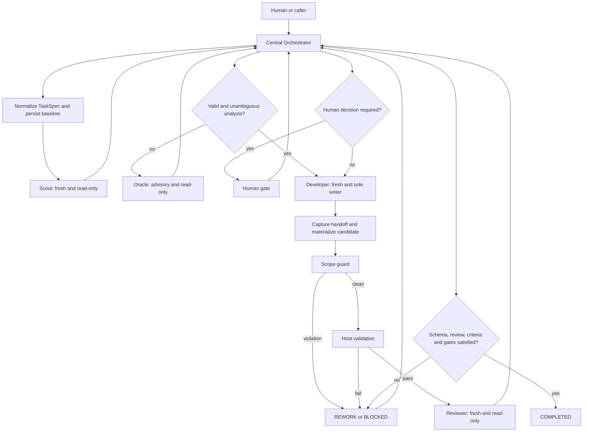

**English** · [Italiano](it/ARCHITECTURE.md)

# Controlled Multi-Agent Development for Pi — Minimal Design

**Status:** normative specification with documentary Operational Registration/RPC Binding amendment; that amendment did not implement P6. **Original P0 observation date:** 2026-09-26. **Observed target:** Pi Coding Agent 0.87.1, pi-subagents 0.71.0, Node.js 22.22.1.

Sections 1 and 16 describe historical P0 observations, not a current implementation inventory. The amendment adopts the boundary explored with pi-subagents 0.72.1 (§1.9), without promoting UV items or resuming P6. Later amendments are explicitly identified below. Current results are in [VALIDATION](VALIDATION.md).

## 0. Phase boundaries

This phase designs a general installable Pi package independent of its target repository. It neither defines application-specific features nor implements code. VERIFIED means observed in the local installation, installed documentation, published declarations or a runtime call; PROPOSED identifies future architectural choices; UNVERIFIED identifies matters not demonstrated in that phase and unavailable as implicit prerequisites.

## 1. Observed pi-subagents capabilities

### 1.1 Installation and compatibility

| Aspect | Historical evidence | Status |
|---|---|---|
| pi-subagents | package.json 0.71.0 | VERIFIED |
| Pi host | pi --version 0.87.1 | VERIFIED |
| Runtime | Node.js 22.22.1; Pi requires >=22.19.0 | VERIFIED |
| Package | ESM, extension ./index.js | VERIFIED |
| Pi peers | @earendil-works/pi-ai >=0.86.1, other Pi peers * | VERIFIED |
| Runtime doctor | async and supervisor channel available, bridge active | VERIFIED |

Pi installs npm, Git and local-path packages containing extensions, skills, prompts or themes. TypeScript/JavaScript extensions run with Pi's process/OS permissions, without a sandbox.

Pi resolves package identity: project entries normally replace equivalent personal entries, and equivalent declarations do not load the same package twice. The consumer must not count disk/npm copies or infer installation paths. What matters is the service available in the current process, regardless of the user's installation method.

Trust Pi, loaded extensions and loaded pi-subagents as infrastructure. Deliberately hostile extensions impersonating the event contract are outside the normal threat model. Concrete observable anomalies must still fail closed.

### 1.2 Observed public APIs

The root export is the extension factory. Historical public subpaths observed were background-work, external-job-provider, external-runs, agents, delegation, capability-ceiling, workflow-resources, required-child-extensions, preflight, control-channel, intercom-bridge, child-tool-plan, shared-types and project-panes under `pi-subagents/`.

Two execution interfaces were observed, but only RPC was adopted:

1. In-process event-bus RPC v1: `subagents:rpc:v1:request`, `subagents:rpc:v1:reply:<requestId>`, `subagents:rpc:v1:ready`; methods ping/status/manage/spawn/steer/interrupt/stop/resume/cost.
2. Structured delegation: `prompt-template:subagent:*`, one foreground leaf with text or schema-validated JSON output.

The adopted registration boundary is `pi-subagents:runtime-agent-register:v1` through `pi.events`: detect the process-local service, validate/register definitions, handle collisions and obtain a disposer. RPC v1 is the sole asynchronous launch/status/completion/control boundary. Registration defines agents without executing them; these are not alternative launchers. Structured delegation and public-subpath imports are outside the adopted design.

Selection is capability-based. Validate RPC v1 and separately project asyncSpawn, status, stop, processTerminalProof, asyncComplete and resume. Provider version is diagnostic telemetry, never a permission switch or future-version blacklist. Missing capability disables its operation and blocks dependent progress.

Live termination support: status+stop+processTerminalProof+asyncComplete permits exact-run stop and bounded verification; without stop, bounded observation only; status alone gives logical state only; without status, the path is unavailable. None creates historical proof: UNKNOWN stays BLOCKED without public historical terminal evidence/completion replay.

No runtime dependency/peer/import or resolution workaround for pi-subagents (§13). RPC manage supports documented schedule actions, not the tool's agent list/create/update operations. Historical source placed asyncComplete under `ping.events`; documentation also mentioned `ping.capabilities.events`. Validate the actual response instead of assuming the shapes equivalent.

### 1.3 Creation and invocation

Observed capabilities: single `{agent,task}` child; JavaScript workflowScript with runs.run/all/lanes/steer; asynchronous workflows (then default); static action validate; agent list/get/create/update/disable/enable/eject/reset; Markdown+YAML profiles from builtin/package/user/project; package profiles through pi.subagents.agents or pi-subagents.agents manifest fields.

Runtime list found 13 builtins, including scout, worker (developer/coder/implementer/develop aliases), reviewer and oracle (advisor alias). External CLI builtins were unavailable on the probe machine; list presence alone proves neither authentication nor launch compatibility.

### 1.4 Context isolation

Fresh creates a new child session. Fork branches a persisted parent and requires session file/current leaf when explicitly requested. An implicit fork default may degrade to fresh for an unpersisted parent; explicit fork fails strictly. Children normally lack subagent; fan-out needs explicit permission/depth limits. Foreground children are in-process; background children use detached runners. Tool restrictions are runtime capability boundaries, not OS isolation.

Managed `worktree:true` requires clean Git and a resolvable commit/ref. The original P0 repository had no commit; testing there would have violated the no-implementation phase boundary, so this capability was not tested then.

### 1.5 Parallelism

Historical observed defaults/capabilities: runs.all fan-out returns an ordered array; runs.lanes combines parallel lanes and sequential stages; globalConcurrencyLimit 20; maxSubagentSpawnsPerRun 64; default main→child→grandchild depth 2. Lanes permit 32 lanes, 16 stages per lane, 64 total stages and 64 KiB canonical JSON.

The minimum design keeps one writer and requires no parallel Developers. Independent read-only reviews could be a later configurable extension.

### 1.6 Results, observability and native persistence

Child output may include ok, runId, output, structuredOutput, outputReference, outputPathMapping and artifactPaths. outputSchema enables validated JSON; file-only output avoids large inline payloads. Observed async resources included status.json, events.jsonl, output logs, transcripts/metadata, subagent:async-complete, terminal workflow receipts and RPC/tool control.

Provider artifacts are execution evidence, not global workflow state. The P0 Scout returned visible Markdown and Reviewer JSON text; inspected metadata/notifications did not prove schema-valid structuredOutput. Successful runs therefore did not certify the required output contract. Missing verified structured output must block acceptance.

Exact/stable completion payload and recovery of structured output after RPC spawn remained UNVERIFIED. Integration needs ping→spawn→completion→status/receipt testing and proven request→run→result correlation through feature detection.

### 1.7 Errors and relevant limits

Launch/schema/timeout errors prevent normal successful completion; a child may recover a single tool error. Explicit failed acceptance gates fail runs, while inferred gates can be observational only: ok:true cannot replace host gates. Infrastructure failure authorizes no silent CLI/foreground/runner fallback.

Stop makes runs non-resumable; interrupt pauses; resume requires persisted sessions and eligibility checks. Steering delivery proves no model compliance. Outputs/reviews are evidence, not authority. Composite async workflows had no default top-level deadline; timeout is no safe writer checkpoint. Managed worktrees require clean trees. pi.events is process-local; extensions have host permissions. Temporary provider artifacts may expire, requiring selective durable capture.

### 1.8 Evidence index and verification level

Symbolic roots avoid publishing private installation paths: **S** is the probe's installed pi-subagents package; **P** is its Pi Coding Agent package. Original paths/transcripts remain in local historical archives.

| Claim | Inspected source |
|---|---|
| Versions/exports/peers | S/package.json, P/package.json, pi --version, node --version |
| RPC/registration | S/docs/extension-api.md, S/src/extension/rpc.js and .d.ts |
| Delegation/preflight | S/src/api/delegation.d.ts, preflight.d.ts |
| Invocation/schema/acceptance/errors | S/docs/tool-reference.md |
| Context/parallelism/worktree handoff | S/docs/workflows.md |
| Profiles/tools/overrides | S/docs/agents.md |
| Defaults/limits | S/docs/configuration.md |
| Artifacts/retention/process proof | S/docs/observability.md |
| Pi packages/security | P/docs/packages.md, extensions.md, security.md |

Parent runtime calls included list with capabilities, doctor, models and version commands. Original transcripts are private; §1.1–1.5 records essential observations.

A runs.all smoke used fresh Scout and Reviewer children. Both completed with results/native notifications; receipt was kept locally under retention. This did not measure temporal overlap or prove leakage isolation. The builtin Scout had write/bash tools, so its read-only probe behavior was instructional, not enforced.

The smoke used the subagent tool, not the future RPC adapter. End-to-end RPC remained unverified. Source/documentation inspection shows available options, not functional tests of each. No destructive, worktree, fork, timeout or crash-recovery test ran in P0.

### 1.9 Spike evidence and amendment limits

Runtime Registration spike with Pi 0.87.1/pi-subagents 0.72.1 demonstrated a consumer without local provider dependency: absent/present owner, synchronous registration, errors/collisions, real RPC/structured output, runtime source/read-only registry/history canary/no-delegation, dispose and new session. This is an experimental baseline, not the earliest compatible release or final-package certification. Earlier releases are admissible if required capability checks pass; no auto-install/update.

Private spike reports/audits/run identities are neither runtime resources nor public material. Experimental source/tool artifact inspection does not authorize an internal production resolver.

Provider launchContractDigest consistency under operator model/provider/thinking overrides remains an unresolved historical issue: spawn/main completion `c7013314…`, child `4245bf3a…`. Preserve distinct values/provenance without normalization. Divergence alone does not block an independently proven package authority contract, but inconsistent/unproven authority does. The amendment promoted none of UV-002/003/009/010 and added no UV-001 attestation.

## 2. Proposed architecture

### 2.1 Minimum components

One Pi extension/manifest; central Orchestrator; immutable hashed TaskSpec normalizer; local atomic JSON snapshot plus append-only JSONL store; process-local registration/lifecycle boundary and separate sole RPC executor; scope guard; explicit-command validation runner with bounded outputs; trusted human adapter. No fifth agent role is needed: deterministic testing, scope checks and transitions belong to the host.

### 2.2 Roles

| Role | Context | Writes | Authority |
|---|---|---|---|
| Orchestrator | Pi host | Ledger/config and deterministic materialization, no semantic correction | Sole global authority |
| Scout | Fresh | None | Structured analysis |
| Developer | Fresh, sole writer, isolated worktree where supported | Authorized candidate files | Implementation, no approval/completion |
| Reviewer | Fresh, separate from Developer | None | Verdict/findings, no correction |
| Oracle | Verified fork or explicitly selected fresh packet | None | Advice on ambiguity/blockage |

Controlled definitions are package-owned, fixed names `controlled.scout`, `controlled.developer`, `controlled.reviewer`, `controlled.oracle`, selected by role rather than TaskSpec/model. Runtime registration is their sole source; builtins remain unchanged. All are leaves. Read-only roles have no generic shell.

Extension-owned fields include base prompt/mode, tool allow/deny, nesting, context/inheritance, extensions, mutation and supported permission/capability constraints. Required unsupported/unverifiable fields block. Operator model/provider/thinking/documented fast preferences are permitted only without expanded authority; lawful preferences are not escalation or automatic fallback.

Pre-spawn Operational Binding requires accepted registration, exact controlled name/definition, live current handle and same-process RPC resolving that name. Post-launch adds valid runId, correlated completion/output and independent EVD-001 checks. No undisclosed provider owner identity is invented. Receipts alone attest no full tools/source/authority snapshot.

Observed collisions, static ambiguity, contradictory replies, failed resolution, unexpected source/effective authority, unattributable output, invalid handles and unreconciled replacement fail closed. Abstract multiple-responder possibility alone does not. No automatic renaming/sanitizing/fallback.

Minimum Scout has fresh context, read only, no delegation/mutation/inheritance/extensions, and only structured_output as internal protocol tool. CLA-001/SCOUT-001 define exact exclusions. Verify actual source/identity/context/tools/no-delegation/output and before/after canary independently. Register at startup, dispose/close owned listeners at shutdown/reload, use fresh handles for every runtime; this normal lifecycle is not crash recovery.

Developer exploratory checks, where permitted, never satisfy authoritative TESTING; the host executes checks and Reviewer assesses them.

## 3. Responsibilities and invariants

Orchestrator freezes/validates TaskSpec, CAS-checks each state revision, creates bounded assignments, validates schemas/role/run/expected state, admits in-scope findings and prevents completion without every gate. Prose is never a verdict.

Registration validates v1 and obtains handles without spawning. RPC verifies readiness/ping/capabilities, uses unique request IDs and durable idempotency keys, and accepts only expected session/run replies. Identical duplicates are idempotent; contradictory payloads, ambiguous timeouts, unknown runs and invalid output block. requestId alone does not guarantee spawn idempotence: lost replies require reconciliation before relaunch. No automatic fallback.

Scope guard records canonical root/HEAD/branch/initial state, compares allow/deny, protects ledger/Git/credentials/external paths, requires separate Developer worktrees where supported and rejects escapes/unattributable dirty data. Validation runner executes only configured commands, binds exact tree/digest, bounds display while retaining referenced evidence, and rejects nonexecution/timeouts/nonzero exit.

## 4. Logical workflow



## 5. State machine

Retain eleven states; child/gate states remain fields. AWAITING_HUMAN freezes resumeState/pendingGate. PENDING is normalized input, ANALYZING is preliminary analysis, READY is frozen unambiguous work, IMPLEMENTING is authorized Developer work, TESTING is host validation, REVIEWING is independent assessment, REWORK is an admitted correction need, BLOCKED is insufficient technical/information conditions, AWAITING_HUMAN is a pending decision, and COMPLETED/FAILED are immutable terminal states.

```text
PENDING -> ANALYZING | AWAITING_HUMAN | FAILED
ANALYZING -> READY | BLOCKED | AWAITING_HUMAN | FAILED
READY -> IMPLEMENTING | AWAITING_HUMAN | FAILED
IMPLEMENTING -> TESTING | REWORK | BLOCKED | AWAITING_HUMAN | FAILED
TESTING -> REVIEWING | REWORK | BLOCKED | FAILED
REVIEWING -> COMPLETED | REWORK | BLOCKED | AWAITING_HUMAN | FAILED
REWORK -> IMPLEMENTING | ANALYZING | BLOCKED | AWAITING_HUMAN | FAILED
BLOCKED -> ANALYZING | REWORK | AWAITING_HUMAN | FAILED
AWAITING_HUMAN -> recorded resumeState | BLOCKED | FAILED
Nonterminal states -> BLOCKED through explicit recovery inconsistency transitions
COMPLETED / FAILED -> no outgoing transition
```

PROTOCOL STM-003 enumerates all 43 exact TRs, including recovery transitions. No unlisted transition is permitted; only Orchestrator acts against the expected revision. Crashes preserve the last valid snapshot and auditable event state. Incompatible concurrent runs block recovery.

Completion needs valid Developer output, in-scope differences, nonempty required actually-passed checks, independent valid review, complete criterion coverage and required authority. resumeState is recorded by host, not chosen by children/users; a final gate returns to REVIEWING for revalidation rather than directly approving terminal state. Human approval cannot turn invalid output or missing tests into success.

## 6. Orchestrator/agent communication

Each prompt derives from a persisted AssignmentEnvelope, not implicit conversation. It binds schema/task/attempt/role/objective, original/base/working roots, scope, requirements/criteria/constraints, evidence, operations, validation, stops and launchContractHash; see DATA-002 for complete fields.

CLA-001 launchContractHash is canonical package-owned deterministic authority available before dispatch: controlled identity/role, registration version, base-prompt hash and context/tools/nesting/inheritance/extensions/constraints. Exclude task prose, volatile runtime paths, IDs/timestamps, transcripts/output and provider digests. Lawful model/provider/thinking/fast choices are separate execution metadata. A hash identifies bytes/policy but proves neither registration authenticity nor enforcement.

DATA-002 v2 prevents reinterpretation of historical v1. Provider digests retain their own provenance and are never substituted for the package hash or forced equal across different objects.

Structured ScoutResult carries observations/files/risks/ambiguities/proposed scope; DeveloperResult summary/files/commands/exploratory tests/risks/blocker; ReviewResult PASS/FAIL/BLOCKED, criteria/findings/scope/test/actual-change assessments and candidate identity; OracleResult diagnosis/options/recommendation/questions/decision need. Every schema is closed, bounded and path-validated. Host revalidates even provider-schema-checked output. Reviewer receives actual requirements/baseline/diff/digest/tests, not Developer's conclusion as authority; mismatched reviewed/tested digest blocks.

## 7. Scope enforcement

Verify canonical roots/paths; capture baseline HEAD/tree/status/dirty files; freeze default-deny exact-file allow/deny; keep one writer in an isolated clean-ref worktree; independently inventory actual differences/untracked files; reject/block outside-scope writes; recheck after rework and before review/completion. Read-only roles lack write/edit/mutating shell/delegation; Developer gets no fan-out, publication, merge or credential authority.

Original proposed handoff anticipated provider cleanup: durably capture/verify handoff and patch, check base/path/integrity and deterministically reconstruct a host-owned candidate checkout from the same base. This is not a second Developer or original-checkout integration. Current Git binding/promotion amendments refine the native implementation while preserving separate candidate authority.

Tests/review bind a digest of full contents, paths and modes, including new/binary files, not merely unchanged base HEAD. Recheck after tests/review/approval. Unexpected mutation invalidates proof. Approved generated output uses separate directories and cannot hide source from the digest. Missing handoff, incomplete/unapplicable patches, unrepresented data, unknown writer exit or digest block. Rework starts from the approved candidate and invalidates prior-generation evidence; ref/patch reconstruction needs integration tests.

Initial mutation admission requires clean committed Git; non-Git/unborn/dirty inputs can be analyzed but require explicit preparation. No automatic commit/stash bypass. Later current-folder setup is separately confirmed. Completion certifies a durable local candidate, not publication/integration.

Allowlists/worktrees reduce risk but are no OS sandbox. Post-run diff detection cannot prevent arbitrary shell writes. Editing-tool confinement needs verified child guards or OS isolation. Generic shell cannot guarantee credential or outside-root isolation; tasks requiring strong confinement block until external isolation is verified.

## 8. Retry and escalation

Default two rework attempts beyond the first, within an approved global ceiling. One proven transient infrastructure retry uses the same protocol after copy/diff checks. Attributed failed tests/Reviewer findings produce bounded rework with a fresh Developer session. Pre-write ambiguity, two equivalent failures or conflicting evidence permit one Oracle per episode. Oracle cannot decide material scope/product/architecture choices. Exhaustion fails unless a concrete finite human decision can enable a legal continuation without raising caps. Extension/launch/protocol failures block without implicit model/runner changes. Counters/fingerprints/escalations remain durable and monotonic; PROTOCOL RET-001 specifies exact limits.

## 9. Human-in-the-loop

Minimum configurable gates: beforeImplementation, always-required onScopeChange, onOracleDecision, beforeCompletion and onRetryExhausted. Later protocol also defines beforeReviewerRedispatch. The P0 command sketch (`start`, `approve`, `reject`, `answer`) was a design proposal; use the [current manual](../USER-MANUAL.md) for actual commands.

Model-callable tools can propose/request/read status, never register human approval. Require explicit positive native TUI choice, current session/data/presentation binding and verified host origin. Current custom panel defaults No, with confirm fallback; Escape/timeout/errors grant nothing. Session identity, child messages and indirect slash invocation alone are insufficient. Headless/RPC without a verified channel remains waiting. Approval binds gate/revision/content hash/evidence/time; later material changes invalidate it. A custom UI is not an authority requirement.

## 10. Plans, current tasks and requirements

The abstract TaskSpec accepts inline data or an explicit JSON/Markdown path inside/outside the repository, without magic PLAN.md/CURRENT.md discovery. It normalizes task identity/title/objective, plan/currentTask sources, requirements/criteria, scope/root/baseRef, commands and gate/retry policies. The current wizard builds this configuration for users.

Copy file input to immutable snapshot artifacts with source path/hash/time. Markdown is context, not implicitly parseable authority. Normalized requirements/criteria need IDs/methods and explicit approval when model-extracted. Ambiguity blocks READY; changed frozen sources require renewed analysis/approval.

## 11. Persistence

Use local structured files outside source by default:

```text
<pi-agent-data>/controlled-dev/projects/<repo-hash>/tasks/<task-id>/
  state.json          # atomic authoritative snapshot
  events.jsonl        # append-only audit
  spec.json           # normalized hashed specification
  artifacts/          # packets, normalized outputs, bounded logs and references
  lock                # exclusive task ownership
```

Persist schema/package versions, task/repository/session/state/revision, hashed spec/source/scope, Git baseline/current digest, request/run/attempt/role, transitions/reasons/actor, retry/escalation/fingerprints, structured outputs/artifacts, command/exit/duration/log/tree, review/findings, human decisions and approved hashes, blocks/risks/Oracle decisions.

Recovery verifies locks, schema/snapshot/event chain, reconciles nonterminal runs through public status/evidence, never relaunches unknown outcomes and resumes only explicit idempotent admitted actions. Contradiction/corruption blocks rather than completes. Under lock, durable event append precedes atomic snapshot replacement; referenced immutable artifacts precede the WAL. Sync/rename errors prevent later effects. Truncated tails grant no transition; PST-002 governs explicit repair. Intent precedes spawn, actual identity follows; the gap never permits blind redispatch.

Task locks alone cannot prevent two writers in one repository: also own its canonical workspace lock. Unproven-dead owners retain locks. New Pi sessions cannot assume authority over old runs; reconcile or block. Keep necessary final patches, normalized results and logs beyond provider retention, without copying full transcripts or accepting vanished temporary references.

## 12. Repository/package structure

The original target organized a thin extensions/controlled-dev.ts entry, deterministic src modules, four unregistered agents/*.md reference profiles, docs and tests. This was a proposed layout, not a phase instruction to create files. Current inventory is checked by scaffold tests. Operational definitions are runtime-owned; Markdown profiles are neither manifest agents nor a second authority source. The public package retains UNLICENSED and has no invented license grant.

## 13. Necessary dependencies

Runtime uses the optional Pi Coding Agent peer; TypeBox was only a proposed peer if tool schemas needed it, not a mandatory current dependency. pi-subagents must be separately loaded to execute children, but is unnecessary merely to install/load this package. Use Node standard library where practical.

Never add runtime pi-subagents dependency/peer (even optional), root/subpath imports, Node/global/home lookup, NODE_PATH, resolution links, vendoring or auto-install/update. Any future type-only study cannot become a runtime requirement. Users select supported installation methods; consumer uses process-local service only.

Minimum registration v1/RPC v1/async spawn/correlated completion/structured-output capabilities must be demonstrated. Absent service gives unavailable without dispatch; incompatible protocol blocks. Observed 0.72.1 is a test baseline, not a blacklist of earlier releases. No new dependency was introduced by the documentary amendment.

## 14. Technical risks and UNVERIFIED items

Historical open obligations: exact async RPC completion/output recovery; final-package registration/binding/collision/source handling across installations (UV-002); effective controlled tools/context/extensions/no-delegation/canaries (UV-003); clean-Git worktree handoff; multiprocess exclusive locks/owner death/sync/rename/crash; reload/session replacement ordering; future-version capability handshake and portable packaging without provider Node resolution (UV-009).

Security remains external: extensions/allowlists/worktrees are not OS sandboxes. Explicit approved tests run with the Pi process's environment/credentials. Schema-valid review can still be semantically wrong; deterministic evidence plus independence does not guarantee universal correctness. The provider digest divergence in §1.9 remains separately attributed, never equated to package authority hashes or used to relax unknown/contradictory-authority blocking.

## 15. Acceptance criteria for implementation

These 34 historical obligations retain their order for TEST-MATRIX AC-P0 traceability:

1. Install from path/tarball without runtime provider dependency; service supplied separately.
2. No machine-local absolute paths or development-repository requirements.
3. Verified registration/RPC Operational Binding; absent service unavailable, incompatible/contradictory evidence blocked, no child/auto-install.
4. No Pi/pi-subagents modification.
5. Reject every illegal state transition.
6. Only Orchestrator writes global state.
7. Invalid schema, missing/failed tests/review, scope/digest mismatch or pending required gates prevent completion.
8. Crash recovery duplicates neither spawn nor approval.
9. Corruption/inconsistency blocks.
10. Scout/Reviewer/Oracle cannot mutate canaries.
11. Developer lacks delegation and global completion authority.
12. Reviewer is fresh, independent and cannot correct its candidate.
13. Reject same-run/session Developer review.
14. Block traversal, symlink escape, outside-allow and denied paths.
15. Detect unattributable dirty baselines.
16. One writer per checkout.
17. Test worktree handoff/reconstruction after child cleanup on committed clean fixtures.
18. Bind tests/review/completion to exact candidate digest including new/binary files; incomplete patches block.
19. Never claim generic-shell path confinement; required strong isolation must be proven externally.
20. Exclude temporary artifacts from published packages.
21. Bind authorized commands to exact tree/digest.
22. Timeout, nonzero exit or nonexecution prevents completion.
23. Schema-valid Reviewer PASS is necessary but insufficient.
24. Rework invalidates old-tree test/review/approval evidence.
25. Persist monotonic retry caps.
26. Repeated failure fingerprints trigger defined escalation.
27. Oracle stays advisory and cannot unblock material decisions automatically.
28. Reject stale revision/hash approval.
29. Reject model/child/indirect-command approval without a trusted human confirmation.
30. Never disguise exhaustion as success.
31. Reconstruct state, attempts, decisions, checks, review, escalation and approvals from ledger/artifacts.
32. Correlate external runs with request/run/role/attempt.
33. Keep secrets/full transcripts outside the ledger.
34. Cover crashes around spawn, completion, state writes and human gates.

## 16. Original P0 internal review (historical)

The documentary checklist covered verified environment/API observations, distinction between evidence and assumptions, general architecture, four roles, sole host authority, Developer/Reviewer separation, all required states/transitions, fail-closed output/tests/scope/recovery, configurable human gates, filename-independent PLAN/CURRENT input, local persistence/audit, package/dependencies/risks/acceptance criteria, and no implementation/external-component changes.

Initial independent review returned **BLOCK** for incomplete worktree handoff, model self-approval risk and missing evidence index. All three were accepted and addressed in §§7,9,1.8. Final verification was internal by the author; no second independent approval is claimed. Run completion was not confused with review verdict.

**Historical phase result: PASS**, documentation only. Fourteen requested topics were covered, with source/task input and final review as additional sections. Real invocation/results were observed; implementation and broad testing were not certified. Open issues remained RPC/schema integration, actual tool/path enforcement, human gate origin, patch reconstruction and crash/lock recovery. The repository then had no commit.

Assumptions: trusted host/extensions/provider; hostile contract impersonation outside normal model; initial mutation on clean committed Git; explicit checks; no OS sandbox, cryptographic provider authentication or mathematically unique internal owner proof; completion certifies a candidate, not merge/publication.

Only docs/ARCHITECTURE.md changed in that phase. Provider-generated external transcripts/receipts/reports were retained privately; no source/configuration/manifest/commit/application feature was changed. The historical phase stopped without authorizing another phase; that statement is an audit fact, not an instruction overriding current user work.

## Candidate Promotion / Git Integration — project-level amendment

New ControlledTasks bind host-owned target/base and stable external candidate branch. ScopeGuard/generation rules govern edits/rework; only after COMPLETED does the host freeze the verified manifest in a commit. Parent/Developer gain no Git tools. Historical tasks retain earlier candidates/recovery/completion packages without retroactive binding.

Promotion uses immutable artifacts in existing project storage, leaving eleven states/43 TR/task authority/completion predicates intact. Prepare an explicit current-target merge, validate exact contents and reuse read-only Reviewer for an advanced target. Direct approval binds the whole proposal before durable intent/ref CAS; policy authority requires a current capability on exact proposal/approved plan/policy without claiming the person saw that concrete commit. Update/verify index/worktree under workspace and Git index locks. Recovery reconciles only that authorized operation, failing closed without reset/stash/rollback.

Planning considers dependencies baseline-ready through exact candidate ancestry or proven no-op; completion alone does not unlock successors. Markdown grants no authority. Require committed Git/local branch/configured identity; command-local hooks/signing disabling changes no permanent settings or remotes. Preserve branch/worktree. See [promotion](CANDIDATE-PROMOTION.md); checkpoints/greenfield are separate features.

## Project Autonomy amendment — 2026-10-04

PA-001 adds bounded project-level sequencing over existing APIs. ProjectAutonomyRepository stores policy/run/audit in DurableStore; controller selects one PlannedTask at a time. Production adapter calls native pre-task Scout, formulation, workflow, promotion and checkpoint. It neither writes WorkflowState nor implements roles/Git/binding decisions.

PolicyDerivedAuthorization is distinct from DirectHumanApproval. Exact native policy approval creates noncopyable single-use local capabilities, rechecking policy/plan/memory/baseline on use. Gate v2/terminal package v3 expose derived provenance; older records remain direct-human. GA adds only PA-001's verified authority alternative, preserving eleven states/43 transitions.

Git progress is a same-run native authorized result chain. Quiescence, actual scope, current validation, independent review, candidate identity, Git identity and budgets remain. Recovery reuses native store/locks/incarnations/tasks; unproven conditions create HumanInterruption without destructive cleanup or replay. Admission to the same run is checked before recovery/continuation. Native NOT_REQUIRED is retained as unchanged-baseline evidence after verified completion. See [autonomy](PROJECT-AUTONOMY.md).

## Domain-package composition

Controlled Dev stays generic for future systemist_factory. `pi-controlled-dev/host` creates the same extension with an immutable phase-specific methodology profile. The profile supplements context without changing launch contracts, authority, checks, state or storage. Technical memory remains existing Project Memory. Domain orchestration owns sources, requirements, traceability and system-level decisions, linking to engine tasks/evidence. [Composition](SYSTEMIST-COMPOSITION.md) distinguishes implemented support from a future request/result adapter.

The protocol completion contract is identified as CMP-001; its numbered conditions must all hold for completion.
