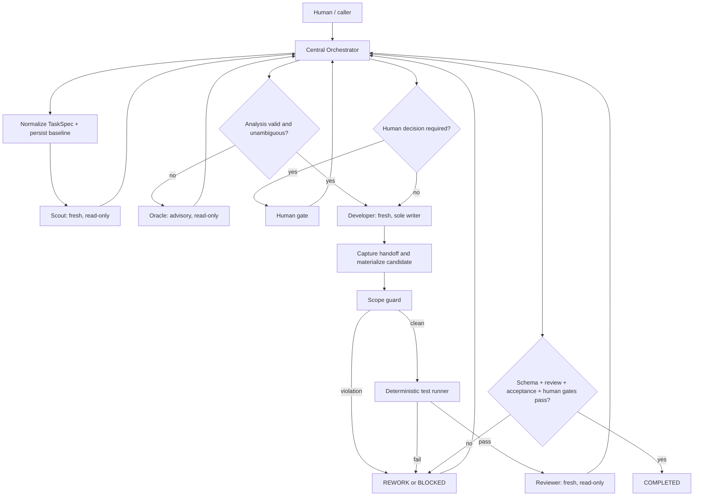

[English](../ARCHITECTURE.md) · **Italiano**

# Controlled Multi-Agent Development for Pi — progettazione minima

**Status:** specifica normativa; amendment documentale Operational Registration/RPC Binding, senza implementazione P6.
**Ambiente verificato:** 2026-09-26
**Target della rilevazione P0 originale:** Pi Coding Agent `0.87.1`, `pi-subagents` `0.71.0`, Node.js `22.22.1`.

Le osservazioni §1 e il resoconto §16 sono storici P0, non un inventario corrente dell'implementazione P0–P5. L'amendment adotta il boundary sperimentato con `pi-subagents 0.72.1` (§1.9), senza promuovere UV né riprendere P6.

## 0. Confini della fase

Questo documento progetta un package Pi generale, installabile e indipendente dal repository sul quale opera. Non definisce funzionalità applicative specifiche e non implementa codice.

Termini:

- **VERIFIED**: osservato nell'installazione locale, nella documentazione installata, nelle dichiarazioni pubblicate o tramite una chiamata runtime.
- **PROPOSED**: scelta architetturale futura.
- **UNVERIFIED**: non dimostrato in questa fase; non può essere usato come requisito implicito.

## 1. Capacità effettivamente verificate di `pi-subagents`

### 1.1 Installazione e compatibilità

| Aspetto | Evidenza | Stato |
|---|---|---|
| Versione `pi-subagents` | `package.json`: `0.71.0` | VERIFIED |
| Versione Pi host | `pi --version`: `0.87.1` | VERIFIED |
| Runtime | Node.js `22.22.1`; Pi richiede `>=22.19.0` | VERIFIED |
| Tipo package | ESM; estensione `./index.js` | VERIFIED |
| Peer Pi | `@earendil-works/pi-ai >=0.86.1`, altri peer Pi `*` | VERIFIED |
| Stato runtime | `subagent({action:"doctor"})`: async disponibile, supervisor channel disponibile, bridge attivo | VERIFIED |

Pi installa package da npm, Git o path locale. Un package Pi può distribuire estensioni, skill, prompt e temi. Le estensioni TypeScript/JavaScript sono eseguite nello stesso processo e con gli stessi permessi OS di Pi: non sono una sandbox.

Pi risolve i package per identità: una entry di progetto normalmente sostituisce l'equivalente personale e dichiarazioni equivalenti non caricano due volte lo stesso package; il consumer non deve dedurre installazioni dal filesystem né contare copie npm sul disco. Per pi-controlled-dev conta il servizio pi-subagents effettivamente disponibile nel processo Pi corrente, qualunque sia il metodo d'installazione scelto dall'utente.

**Trust model:** host Pi, extension caricate e pi-subagents già caricato sono trusted infrastructure. pi-controlled-dev non isola da extension Pi malevole; componenti ostili che imitano intenzionalmente lo stesso event contract sono fuori dal threat model normale. Restano obbligatori i controlli fail-closed sulle anomalie concretamente osservabili.

### 1.2 API pubbliche osservate

L'export root di `pi-subagents` espone solo la factory dell'estensione. I subpath pubblici installati sono:

- `pi-subagents/background-work`
- `pi-subagents/external-job-provider`
- `pi-subagents/external-runs`
- `pi-subagents/agents`
- `pi-subagents/delegation`
- `pi-subagents/capability-ceiling`
- `pi-subagents/workflow-resources`
- `pi-subagents/required-child-extensions`
- `pi-subagents/preflight`
- `pi-subagents/control-channel`
- `pi-subagents/intercom-bridge`
- `pi-subagents/child-tool-plan`
- `pi-subagents/shared-types`
- `pi-subagents/project-panes`

Nella rilevazione P0 originale erano inoltre osservati i seguenti confini pubblici (non entrambi adottati dal package):

1. **RPC event-bus in-process v1** — eventi `subagents:rpc:v1:request`, `subagents:rpc:v1:reply:<requestId>` e `subagents:rpc:v1:ready`; metodi `ping`, `status`, `manage`, `spawn`, `steer`, `interrupt`, `stop`, `resume`, `cost`.
2. **Structured delegation API** — eventi `prompt-template:subagent:*`; esegue un singolo leaf agent foreground e può richiedere output testuale o JSON validato da schema.

Boundary adottati: **runtime registration** tramite `pi-subagents:runtime-agent-register:v1` su `pi.events`, per rilevare il servizio process-local, validare/registrare la definition, gestire collisioni e ottenere il disposer; **RPC event-bus v1** come unico confine di esecuzione asincrona, status, completion e controllo di run attribuiti. Registration definisce l'agente, non lo esegue: non sono due launcher e non esiste fallback fra i boundary. Structured delegation e import dei subpath elencati sopra non fanno parte del design adottato.

La selezione operativa è esclusivamente capability-based. Il handshake valida il protocollo RPC v1 e proietta separatamente le capability pubbliche effettive (`asyncSpawn`, `status`, `stop`, `processTerminalProof`, `asyncComplete`, `resume`). Il numero di versione del provider è telemetria diagnostica: non abilita capability, non seleziona percorsi di sicurezza e non esclude versioni future sconosciute. Capability assente significa funzione indisponibile e, dove la prova è necessaria, avanzamento bloccato.

Matrice della terminazione live: `status + stop + processTerminalProof + asyncComplete` abilita arresto mirato e verifica bounded; senza `stop` resta la sola osservazione bounded; con il solo `status` è disponibile esclusivamente lo stato logico; senza `status` il percorso non è disponibile. Nessuna di queste combinazioni crea una prova storica: senza completion replay o prova terminale storica pubblica, un run `UNKNOWN` resta `BLOCKED`.

La discovery riguarda capability nel processo corrente, non la posizione dell'installazione. Vietati dependency/peer dependency runtime su pi-subagents, import runtime `pi-subagents` o `pi-subagents/*` e workaround di risoluzione (§13). RPC `manage` consente soltanto le azioni schedule documentate: non espone `list/create/update` degli agenti. Queste ultime appartengono al tool, non a quel metodo RPC. Il sorgente installato `src/extension/rpc.js` colloca il nome evento in `ping.events.asyncComplete`; la documentazione menziona anche `ping.capabilities.events.asyncComplete`. L'adapter dovrà validare la risposta effettiva, senza assumere equivalenza fra le due forme.

### 1.3 Creazione e invocazione dei sub-agent

Sono disponibili e verificati:

- singolo child: `{ agent, task }`;
- workflow JavaScript: `workflowScript` con `runs.run(key, ...)`, `runs.all([...])`, `runs.lanes([...])`, `runs.steer(...)`;
- esecuzione asincrona, default corrente per i workflow;
- validazione statica con `action: "validate"`;
- agent discovery/management con `list`, `get`, `create`, `update`, `disable`, `enable`, `eject`, `reset`;
- agent definiti come Markdown + YAML frontmatter in scope builtin/package/user/project;
- package agent esponibili tramite `pi.subagents.agents` o `pi-subagents.agents` nel manifest del package.

La chiamata runtime `list` ha rilevato 13 agent builtin. I ruoli pertinenti sono:

- `scout`;
- `worker`, con alias `developer`, `coder`, `implementer`, `develop`;
- `reviewer`;
- `oracle`, alias `advisor`.

Gli external CLI builtin risultano non disponibili su questa macchina; la sola presenza nella lista non prova autenticazione o compatibilità di lancio.

### 1.4 Isolamento del contesto

- `context: "fresh"`: nuova sessione child; adatto a Developer e Reviewer.
- `context: "fork"`: branch della sessione parent persistita; richiede session file e current leaf quando richiesto esplicitamente.
- Un default implicito `fork` può degradare a `fresh` se il parent non è persistito; un `fork` esplicito fallisce invece in modo stretto.
- I child non ricevono normalmente il tool `subagent`; il fan-out richiede autorizzazione esplicita e resta soggetto al limite di profondità.
- I foreground child sono sessioni in-process; i background child sono sessioni in un runner detached.
- Le restrizioni tool sono capability boundaries del runtime Pi, non isolamento OS.

Per modifiche concorrenti, `worktree: true` crea worktree Git gestiti. Richiede repository Git pulito e un commit/ref risolvibile. **Il repository corrente non ha ancora commit**, quindi questa capacità non è collaudabile qui senza violare il vincolo di non avviare l'implementazione.

### 1.5 Parallelismo

- `runs.all` esegue fan-out parallelo e restituisce un array ordinato.
- `runs.lanes` supporta lane parallele con stage sequenziali.
- Default verificato: `globalConcurrencyLimit = 20`.
- Default verificato: `maxSubagentSpawnsPerRun = 64`.
- Limite di nesting predefinito: main → child → grandchild (profondità 2).
- `runs.lanes` limita l'inventario a 32 lane, 16 stage/lane, 64 stage totali e 64 KiB JSON canonico.

Il design minimo non richiede Developer paralleli: mantiene un solo writer. Può parallelizzare solo review indipendenti in una futura estensione configurabile.

### 1.6 Risultati, osservabilità e persistenza nativa

I risultati child possono includere `ok`, `runId`, `output`, `structuredOutput`, `outputReference`, `outputPathMapping` e `artifactPaths`. `outputSchema` abilita output JSON validato. `outputMode: "file-only"` evita grandi payload inline.

Per i run asincroni sono verificati:

- `status.json`;
- `events.jsonl`;
- `output-<n>.log`;
- transcript e metadata;
- evento `subagent:async-complete`;
- receipt terminale dei workflow;
- status e controllo tramite RPC/tool.

Gli artifact di `pi-subagents` sono evidenza di esecuzione, non lo stato globale del workflow proposto. Nel probe di questa fase il risultato Scout visibile è Markdown e quello Reviewer è testo JSON; la notifica e i metadata ispezionati non provano la presenza di `structuredOutput` schema-valid. Il successo dei run non certifica quindi il contratto di output richiesto: tale enforcement end-to-end resta UNVERIFIED e deve bloccare la futura accettazione se il campo validato manca.

**UNVERIFIED:** forma esatta e stabilità del payload `subagent:async-complete` utile a recuperare `structuredOutput` dopo un `spawn` RPC. Prima dell'implementazione va eseguito un integration test contro `ping`, `spawn`, completion event e `status`/receipt. Il design deve usare feature detection e fallire chiuso se la correlazione `requestId → runId → risultato` non è dimostrabile.

### 1.7 Errori e limiti rilevanti

Comportamenti verificati:

- errori di launch, schema e timeout impediscono una normale conclusione riuscita; un errore di un singolo tool può invece essere recuperato dal child;
- gate acceptance espliciti falliti fanno fallire il run; gate inferiti possono restare soltanto osservabili senza far fallire il run. Quindi `ok: true` non sostituisce i gate dell'orchestratore;
- una failure infrastrutturale non autorizza fallback silenziosi verso CLI, foreground o altro runner;
- `stop` rende un run non resumable; `interrupt` lo lascia paused; `resume` richiede sessione persistita e passa controlli di eleggibilità;
- steering delivery non prova che il modello abbia rispettato il messaggio;
- output del child e review sono evidenza, non autorità;
- workflow async compositi non hanno deadline top-level predefinita;
- timeout non è una frontiera sicura per un writer durante una mutazione;
- i managed worktree richiedono tree pulito;
- `pi.events` è solo in-process;
- le estensioni hanno i permessi del processo Pi;
- i risultati temporanei possono essere soggetti a retention: l'orchestratore deve copiare nel proprio ledger solo riferimenti ed evidenze necessarie.

### 1.8 Indice delle evidenze e livello di verifica

Radici simboliche delle installazioni ispezionate (i percorsi personali originali sono conservati nell’archivio privato):

- **S:** radice del package `pi-subagents` installato nel profilo della prova.
- **P:** radice del package `@earendil-works/pi-coding-agent` usato nella prova.

| Affermazione | Fonte ispezionata |
|---|---|
| Versioni, export e peer | `S/package.json`, `P/package.json`; comandi `pi --version`, `node --version` |
| RPC e registrazione agent | `S/docs/extension-api.md`, sezioni In-process event-bus RPC e Runtime agent registration; `S/src/extension/rpc.js` e `.d.ts` |
| Delegation/preflight | `S/src/api/delegation.d.ts`, `S/src/api/preflight.d.ts` |
| Invocazione, schema, acceptance/errori | `S/docs/tool-reference.md`, Execution examples / Acceptance gates |
| Contesto, parallelismo, handoff worktree | `S/docs/workflows.md`, Scripted workflows / Worktree isolation |
| Profili, tool e override | `S/docs/agents.md`, Where agents live / Tool and extension selection |
| Default e limiti | `S/docs/configuration.md`, globalConcurrencyLimit / maxSubagentSpawnsPerRun / timeoutMs |
| Artifact, retention e process proof | `S/docs/observability.md`, Async run artifacts / Process-terminal proof |
| Package e sicurezza Pi | `P/docs/packages.md`, `P/docs/extensions.md`, `P/docs/security.md` |

Chiamate runtime del parent: `list(capabilities:true)`, `doctor`, `models`, version commands. Evidenza originale in un transcript locale conservato fuori dal repository pubblico; risultati essenziali trascritti nelle sezioni 1.1–1.5. Non pubblicare il transcript: può contenere dati privati.

Smoke runtime della fase: `runs.all` con due child configurati `fresh`, Scout e Reviewer. Entrambi completati; invocazione, ritorno risultati e notifiche native osservati. Receipt conservata fra le evidenze locali soggette a retention. Il successo del fan-out non è un benchmark di sovrapposizione temporale né una prova di isolamento contro leakage. Scout ha evidenziato che il builtin dispone di `write` e `bash`: il suo comportamento read-only nel probe era istruzionale, non enforcement.

Questa prova usa il tool `subagent`, **non** il futuro adapter RPC: l'integrazione RPC end-to-end rimane UNVERIFIED. I fatti tratti da sorgenti/documentazione indicano capacità presenti nell'installazione, non test funzionali di ogni opzione. Nessun test distruttivo, worktree, fork, timeout o crash recovery eseguito.

### 1.9 Evidenza dello spike e limiti dell'amendment

Lo spike Runtime Agent Registration ha dimostrato con Pi `0.87.1` / pi-subagents `0.72.1` un consumer senza dependency locale: owner absent/present, registrazione sincrona, errori/collisioni, RPC reale, structured output, source runtime, tool registry read-only, history-canary, no-delegation, dispose e nuova sessione. È una baseline sperimentale, non una minimum release storicamente provata né collaudo del package finale. Release precedenti sono ammissibili se superano le capability richieste. Nessuna installazione o aggiornamento automatico.

Evidenze locali dello spike, non risorse runtime né pubblicabili: report, audit e identificativi dei run normale e con override, conservati fuori dal repository. La lettura degli artifact per source/tools è stata sperimentale, non autorizza un resolver production basato su internals.

Resta aperta **provider launchContractDigest consistency under operator model/provider/thinking overrides**: digest spawn/completion principale `c7013314…`, digest child `4245bf3a…`; causa non dimostrata. Conservare valori e provenienze distinti, senza normalizzazione. Questa divergenza non blocca da sola il nostro authority contract se le proprietà di authority sono verificate indipendentemente; una loro incoerenza/assenza di prova continua a bloccare. Nessuna promozione UV-002/003/009/010 o nuova attestazione UV-001 avviene nell'amendment.

## 2. Architettura proposta

### 2.1 Componenti minimi

1. **Pi package manifest** — espone una sola estensione; nessun profilo statico concorrente registrato per i ruoli controllati.
2. **Orchestrator extension** — unica autorità sulle transizioni, sugli spawn, sui retry, sui gate e sul completamento.
3. **Task normalizer** — converte input inline/path in un `TaskSpec` immutabile con hash.
4. **State store locale** — snapshot JSON atomico + event log JSONL append-only.
5. **Boundary pi-subagents** — registration process-local e handle di lifecycle separati dall'adapter RPC v1, unico executor; correlazione e validazione dei risultati.
6. **Scope guard** — baseline Git, allow/deny path, controllo diff e file non autorizzati.
7. **Validation runner** — esegue soltanto comandi esplicitamente configurati nel task/policy e conserva exit code/output bounded.
8. **Human gate adapter** — comandi umani `approve`, `reject`, `answer`; tool del modello limitati a proposta/richiesta e `status`, mai approvazione.

Nessun quinto ruolo agent è necessario. Testing, scope checking e state transition sono più affidabili come componenti deterministici dell'orchestratore, non come agenti autonomi.

### 2.2 Ruoli

| Ruolo | Contesto | Scrittura | Autorità |
|---|---|---:|---|
| Orchestrator | sessione Pi host | ledger/config e materializzazione deterministica del candidato, non correzioni | unica autorità globale |
| Scout | `fresh` | no | produce analisi strutturata; non pianifica lo stato |
| Developer | `fresh`, singolo writer, worktree isolato quando possibile | sì, solo scope autorizzato | implementa; non approva e non completa |
| Reviewer | `fresh`, separato dal Developer | no | produce verdict/findings; non corregge |
| Oracle | `fork` se disponibile, altrimenti packet `fresh` esplicito | no | consiglio su ambiguità/blocco; non decide |

Un **Controlled Runtime Agent** è una definition posseduta da pi-controlled-dev, registrata tramite il servizio pi-subagents process-local e lanciata tramite RPC nello stesso runtime Pi. I nomi fissi sono `controlled.scout`, `controlled.developer`, `controlled.reviewer`, `controlled.oracle`, scelti dal package in base al ruolo, mai da TaskSpec/output del modello. Runtime registration è l'unica fonte controllata di definition; nessun builtin viene modificato. Tutti i child sono leaf, Developer unico writer scoped, gli altri read-only senza shell generica.

**EXTENSION-OWNED:** prompt base/mode, allowlist ed esclusioni tool, nesting, context policy, inheritance project/global/skills, extensions/subagent-only extensions, mutation policy e permissions/capability constraints supportate. Configurazioni normali non possono ampliarli. Campo necessario non supportato/non verificabile → BLOCKED, non omissione permissiva. **OPERATOR-CONFIGURABLE:** model/provider/thinking e fast documentato, se non ampliano authority. Una preferenza lecita non è escalation né fallback automatico.

**Operational Binding:** prima dello spawn servono registration accepted, nome runtime esattamente controllato dal package, definition prodotta da pi-controlled-dev, handle vivo del runtime corrente e RPC v1 disponibile nello stesso processo che risolve quel medesimo nome. Dopo il launch, spawn deve avere restituito un runId valido, completion e structured output devono essere correlati e attribuiti, e i controlli EVD-001 non devono rilevare contraddizioni. L'insieme di queste prove è il binding registration→execution richiesto; nessun owner ID non esposto dall'API è necessario.

La receipt non attesta da sola snapshot tools/source o authority completa. Collisioni runtime, ambiguità con profili statici, reply concretamente contraddittorie, mancata risoluzione RPC, source inattesa, authority effettiva discordante, output non attribuibile, handle invalido o replacement runtime/sessione non riconciliato devono fallire chiuso. La mera possibilità astratta di più responder non blocca; responder incompatibili effettivamente osservati sì. Nessun rename, sanitize o fallback automatico.

Il futuro Scout usa `controlled.scout`, fresh, allowlist minima `read`, niente delegazione/mutation tools/inheritance, extensions e subagent-only extensions vuote. Il solo tool interno `structured_output` necessario a ScoutResult è previsto separatamente; nessun altro tool ambient. Esclusioni e policy precise sono in PROTOCOL.md CLA-001/SCOUT-001. Dopo launch si verificano indipendentemente source/identity/context/tools/no-delegation, output attribuito e canary/diff read-only. Allowlist non significa sandbox OS.

L'host registra a session startup quando il servizio compatibile è disponibile, conserva il handle solo nel runtime corrente e chiama dispose durante shutdown/reload cleanup; ogni nuovo runtime/sessione richiede nuova registrazione. Non ricostruire handle da JSON, né riusare quelli precedenti. Questo lifecycle normale non è crash/reconciliation recovery (§11).

Il Developer può eseguire controlli esplorativi durante l'implementazione, ma i suoi risultati non soddisfano il gate TESTING: la validazione autorevole viene eseguita dall'orchestratore e verificata dal Reviewer.

## 3. Responsabilità e invarianti

### Orchestrator

- valida e congela `TaskSpec`;
- effettua ogni transizione con compare-and-swap sulla revisione dello stato;
- crea assignment bounded;
- valida schema, identità del ruolo, run id e stato atteso;
- decide quali finding accettare, sempre entro scope;
- impedisce `COMPLETED` senza tutti i gate;
- non interpreta testo libero come verdict.

### Registration e adapter `pi-subagents`

- registration boundary verifica il contratto v1 e acquisisce il handle; nessuno spawn o transizione globale deriva dall'accettazione;
- lega operativamente registration e RPC nello stesso runtime Pi tramite nome controllato, run e completion correlati, senza inventare owner identity non esposte;
- RPC attende/riscontra `ready`, esegue `ping` e verifica capability richieste;
- usa request id univoci e idempotency key persistite;
- accetta solo reply/eventi della sessione e del run attesi;
- ignora duplicati identici già registrati; payload duplicati contraddittori, timeout ambiguo, run sconosciuto e output invalido bloccano l'avanzamento;
- non assume che RPC `requestId` garantisca idempotenza dello spawn: se la risposta si perde dopo dispatch, registra esito ignoto e riconcilia prima di ogni rilancio;
- non effettua fallback automatici.

### Scope guard

- registra repo root canonico, HEAD, branch e stato iniziale;
- confronta file modificati con allowlist/denylist;
- vieta modifiche al ledger, `.git`, credenziali e path fuori root;
- richiede worktree separato per il Developer quando Git lo consente;
- blocca symlink/path traversal e cambiamenti preesistenti non attribuibili.

### Validation runner

- esegue ogni comando autorizzato senza inferire nuovi comandi;
- associa risultato a commit/tree hash esatto;
- tronca la vista ma conserva artifact referenziato;
- fallisce chiuso su comando non eseguito, timeout o exit non-zero.

## 4. Diagramma logico del workflow



## 5. Macchina a stati

Gli stati richiesti vengono mantenuti tutti. Non si aggiungono stati: run child e gate sono campi dello stato, non stati globali. `AWAITING_HUMAN` conserva `resumeState` e `pendingGate`, evitando transizioni ambigue.

| Stato | Significato |
|---|---|
| `PENDING` | task normalizzato ma non avviato |
| `ANALYZING` | Scout/Oracle o verifica preliminare attiva |
| `READY` | scope, requisiti e piano operativo congelati |
| `IMPLEMENTING` | unico Developer autorizzato attivo |
| `TESTING` | scope/diff check e comandi di verifica |
| `REVIEWING` | Reviewer indipendente attivo |
| `REWORK` | finding/failure ammesso richiede nuovo assignment |
| `BLOCKED` | impossibilità tecnica o informativa senza decisione automatica sicura |
| `AWAITING_HUMAN` | gate o decisione umana pendente |
| `COMPLETED` | tutti i gate obbligatori soddisfatti |
| `FAILED` | terminale: policy/retry esauriti o fallimento non recuperabile |

Transizioni consentite:

```text
PENDING -> ANALYZING | AWAITING_HUMAN | FAILED
ANALYZING -> READY | BLOCKED | AWAITING_HUMAN | FAILED
READY -> IMPLEMENTING | AWAITING_HUMAN | FAILED
IMPLEMENTING -> TESTING | REWORK | BLOCKED | AWAITING_HUMAN | FAILED
TESTING -> REVIEWING | REWORK | BLOCKED | FAILED
REVIEWING -> COMPLETED | REWORK | BLOCKED | AWAITING_HUMAN | FAILED
REWORK -> IMPLEMENTING | ANALYZING | BLOCKED | AWAITING_HUMAN | FAILED
BLOCKED -> ANALYZING | REWORK | AWAITING_HUMAN | FAILED
AWAITING_HUMAN -> resumeState | BLOCKED | FAILED
Ogni stato non terminale -> BLOCKED su recovery incoerente
COMPLETED -> (nessuna)
FAILED -> (nessuna)
```

Regole fail-closed:

- nessuna transizione non elencata;
- transizione solo dall'orchestratore e solo dalla revisione attesa;
- crash durante una transizione lascia l'ultimo snapshot valido e un evento incompleto recuperabile;
- uno stato con run concorrenti incompatibili diventa `BLOCKED` al recovery;
- `COMPLETED` richiede: output Developer valido, diff in scope, tutte le verifiche richieste realmente eseguite e riuscite (elenco non vuoto), Reviewer indipendente con verdict valido, ogni criterio di accettazione verificato e gate umani richiesti approvati;
- `resumeState` non è un valore scelto dall'utente o dal child: è un target registrato dall'orchestratore. Per il gate finale riporta a `REVIEWING`, che ricontrolla le evidenze prima di `COMPLETED`; mai approvazione diretta dello stato terminale;
- un'approvazione umana non trasforma test mancanti o output invalido in successo.

## 6. Comunicazione orchestratore/sub-agent

Ogni prompt è derivato da un envelope persistito, non dalla conversazione implicita.

### `AssignmentEnvelope`

```text
schemaVersion, taskId, attemptId, role, objective,
repoRoot, baseRef, allowedPaths, deniedPaths,
requirements[], acceptanceCriteria[], constraints[],
inputArtifactRefs[], authority, validationCommands[], stopConditions[], launchContractHash
```

`launchContractHash` identifica il **ControlledLaunchContract** chiuso di PROTOCOL.md CLA-001: SHA-256 della canonicalizzazione DAT-000 della sola authority deterministica posseduta dal package e disponibile prima del dispatch. Include identità/ruolo, protocollo registration, hash del prompt base, policy context/tools/nesting/inheritance/extensions e vincoli. Esclude task text, runId, timestamp, path runtime, transcript/output e digest del provider. Model/provider/thinking/fast non-authority sono execution metadata separati e non cambiano questo hash. L'hash identifica byte/policy, non autentica una registrazione né prova enforcement.

DATA-002 passa a schemaVersion 2 per impedire reinterpretazione della vecchia semantica v1; nessuna migrazione implicita. Il digest del provider resta evidenza provider con la propria provenienza, mai copia/sostituto del nostro hash né uguaglianza imposta fra oggetti diversi.

### Output strutturati

- `ScoutResult`: `observations[]`, `relevantFiles[]`, `risks[]`, `ambiguities[]`, `recommendedScope`.
- `DeveloperResult`: `summary`, `changedFiles[]`, `commandsRun[]`, `tests[]`, `residualRisks[]`, `blockedReason?`.
- `ReviewResult`: `verdict = PASS|FAIL|BLOCKED`, `criteria[]`, `findings[]`, `scopeAssessment`, `testAssessment`, `reviewedTreeHash`.
- `OracleResult`: `diagnosis`, `options[]`, `recommendation`, `unresolvedQuestions[]`, `needsHumanDecision`.

Ogni schema usa `additionalProperties: false`, limiti di lunghezza/numero e riferimenti a path relativi canonici. L'orchestratore valida nuovamente l'output anche se `pi-subagents` ha applicato `outputSchema`. Testo libero non cambia lo stato.

Il Reviewer riceve requisiti, acceptance criteria, baseline, diff/tree hash e risultati test, ma non la conclusione del Developer come fatto autorevole. Il Reviewer deve riferirsi allo stesso tree hash sottoposto ai test; mismatch implica `BLOCKED`.

## 7. Scope enforcement

1. Normalizzare root e path con `realpath`; rifiutare escape e symlink non consentiti.
2. Catturare `HEAD`, tree/status iniziale e file preesistenti dirty.
3. Congelare `allowedPaths` e `deniedPaths`; default fail-closed: se non dichiarato, nessuna modifica autorizzata.
4. Usare un solo Developer; preferire managed worktree da ref pulito.
5. Dopo il run, calcolare diff e file untracked dal filesystem/Git, senza fidarsi del report child.
6. Qualunque file fuori scope porta a `REWORK` o `BLOCKED`; nessuna correzione silenziosa del Reviewer.
7. Rieseguire scope check dopo ogni rework e prima di review/completion.
8. Capability profile: Scout/Reviewer/Oracle senza `edit`, `write`, shell mutante o `subagent`; Developer senza fan-out, publish, merge o credenziali.

**Handoff del worktree (PROPOSED):** `pi-subagents` può catturare una patch e rimuovere il worktree child alla fine del run. Non si assume quindi che quel checkout esista ancora. Prima di TESTING, l'orchestratore valida e copia handoff/patch in storage durevole, controlla base commit, path e integrità, quindi applica senza modifiche semantiche la patch in un checkout candidato dedicato da quella stessa base. Questo checkout è dell'orchestratore, distinto da quello temporaneo del child; creazione e applicazione patch sono operazioni deterministiche, non un secondo Developer. Nessuna applicazione sul checkout originale dell'utente e nessun merge/push automatico.

Test e Reviewer operano sul candidato identificato da un digest comprensivo di contenuto, path e mode dei file (inclusi nuovi file), non dal solo HEAD rimasto alla base. Si ricontrolla il digest dopo test, review e gate umano; qualsiasi mutazione inattesa invalida le evidenze. Log e build artifact consentiti hanno directory esplicite separate e non possono escludere codice dall'hash. Mancata cattura, patch incompleta, applicazione fallita, file binari/non tracciati non rappresentati, processo writer non sicuramente terminato o digest ignoto → `BLOCKED`. I rework partono dalla base candidata approvata e invalidano test e review precedenti; preparazione della ref locale e round-trip della patch sono da integration-testare.

Per il minimo iniziale il backend di mutazione richiede Git con commit e baseline pulita; repository unborn/dirty/non-Git possono essere analizzati, ma la scrittura resta `BLOCKED` in attesa di preparazione umana. Nessun commit/stash automatico per aggirare la precondizione. `COMPLETED` significa candidato locale validato con patch/evidenze durevoli, non modifica pubblicata o integrata.

Nota: tool allowlist e worktree riducono il rischio ma non sono sandbox OS. Diff checking è rilevazione post-run, non prevenzione di una scrittura arbitraria effettuata via shell. La prevenzione su path dei tool di editing richiede un guard child verificato, oppure isolamento OS; non attribuirla alla sola allowlist. Con shell generica non è garantita l'assenza di accesso a credenziali o scritture fuori checkout. Se il task richiede tale garanzia, l'orchestratore deve bloccare la mutazione finché esiste un isolamento esterno verificato. Questa è una precondizione di sicurezza, non una funzionalità sandbox da implementare in questa fase.

## 8. Retry ed escalation

Default proposto: massimo **2 rework attempt** oltre al primo tentativo, configurabile per task entro un tetto globale.

- Errore transitorio infrastrutturale dimostrato: un solo retry dello stesso protocollo, dopo controllo di worktree/diff.
- Finding del Reviewer o test fallito attribuibile: `REWORK`, nuovo assignment bounded allo stesso Developer role ma nuova sessione fresh.
- Ambiguità prima della scrittura, due fallimenti equivalenti o conflitto tra evidenze: consultare Oracle una volta per escalation episode.
- Oracle non risolve né approva: se resta una scelta di prodotto/scope/architettura, `AWAITING_HUMAN`.
- Retry esauriti: `FAILED`, oppure `AWAITING_HUMAN` soltanto se esiste una decisione umana concreta che può sbloccare.
- Failure di estensione, launch o protocollo: `BLOCKED`; nessun cambio runner/modello implicito.

I contatori sono monotoni e persistiti per `phase`, `attempt`, `failureFingerprint` ed `escalation`.

## 9. Human-in-the-loop

Gate configurabili minimi:

- `beforeImplementation`;
- `onScopeChange` (sempre obbligatorio, non disattivabile);
- `onOracleDecision`;
- `beforeCompletion`;
- `onRetryExhausted`.

Interfaccia minima proposta:

```text
/controlled-dev start <task-spec-path>
/controlled-dev status [task-id]
/controlled-dev approve <task-id> <gate-id>
/controlled-dev reject <task-id> <gate-id> [reason]
/controlled-dev answer <task-id> <gate-id> <text>
```

I tool model-callable possono soltanto proporre decisioni, richiedere conferma e leggere stato: **non** espongono un'azione che registri approvazione umana. `approve/reject/answer` richiedono input umano diretto tramite il comando e una scelta positiva esplicita nella TUI di Pi (`ctx.ui.custom` nel pannello corrente, `ctx.ui.confirm` come fallback). La sola session identity, un messaggio child o testo del modello non provano origine umana. La scelta iniziale del pannello è No; Esc, timeout ed errori non approvano. L'Orchestrator lega la scelta alla sessione, ai dati approvati e alla presentation corrente prima di persisterla. In modalità headless/RPC senza un canale umano fidato verificato, il gate rimane `AWAITING_HUMAN`. La provenienza del comando/conferma va collaudata prima di abilitare questi gate; non basta che un modello invochi indirettamente una slash command.

L'approvazione include `gateId`, `stateRevision`, evidenza della conferma umana, timestamp e hash del contenuto approvato; una modifica successiva invalida il gate. Nessuna UI custom è necessaria.

## 10. Piano, task corrente e requisiti

Il package accetta un `TaskSpec` generale tramite:

- oggetto inline passato al tool/comando; oppure
- path esplicito a JSON/Markdown nel repository o fuori dal repository.

Non cerca automaticamente `PLAN.md`, `CURRENT.md` o nomi equivalenti. I campi minimi normalizzati sono:

```text
taskId, title, objective,
plan: { inline? | path? },
currentTask: { inline? | path? },
requirements[], acceptanceCriteria[],
scope: { repoRoot, allowedPaths[], deniedPaths[], baseRef? },
validationCommands[], humanGates?, retryPolicy?
```

Contenuti da file vengono copiati come artifact snapshot con path sorgente, hash e timestamp. Markdown è materiale di contesto, non uno schema implicitamente parsabile: requisiti e criteri normalizzati devono avere ID e metodo di verifica espliciti e vanno approvati se estratti dal modello. Input ambigui non diventano READY. Cambiamenti delle sorgenti dopo `READY` invalidano il task e richiedono nuova analisi/approvazione.

## 11. Persistenza

File locali strutturati sono sufficienti. Directory proposta, fuori dai source file per default:

```text
<pi-agent-data>/controlled-dev/projects/<repo-hash>/tasks/<task-id>/
  state.json          # snapshot autorevole, scritto atomicamente
  events.jsonl        # audit append-only
  spec.json           # TaskSpec normalizzato e hashato
  artifacts/          # packet, output normalizzati, log bounded/riferimenti
  lock                # lock esclusivo per task
```

Dati da persistere:

- schema/package version;
- task id, repo canonicale, session id, stato/revisione;
- spec e hash di piano/task/requisiti/scope;
- baseline Git e tree hash correnti;
- run/request/attempt id e ruolo;
- transizioni con motivo e attore;
- retry/escalation/failure fingerprint;
- risultati strutturati e artifact reference;
- comandi test, exit code, durata, output reference e tree hash;
- review verdict/findings e reviewed tree hash;
- gate umani e hash approvato;
- errori, blocchi, residual risks e decisioni Oracle.

Recovery:

1. acquisire lock;
2. validare schema, snapshot e sequenza eventi;
3. riconciliare i run non terminali via RPC `status`;
4. non rilanciare se l'esito è ignoto;
5. stato incoerente/corrotto → `BLOCKED`, mai `COMPLETED`;
6. riprendere solo da una transizione esplicita e idempotente.

Commit locale proposto: sotto lock, append dell'evento completo con sequenza/revisione e sync, poi snapshot temporaneo + rename atomico. L'evento durable autorizza l'aggiornamento; lo snapshot è la vista corrente ricostruibile. Recovery riproduce solo eventi completi e validi successivi alla revisione dello snapshot; una coda troncata non autorizza alcuna transizione. Errori di sync/rename o sequenze contraddittorie bloccano ulteriori side effect. Prima di spawn si registra l'intento; dopo spawn si registra l'identità effettiva. Crash tra i due non autorizza redispatch alla cieca.

Il lock per task non basta contro due task writer nello stesso checkout: acquisire anche un lock per workspace canonico. Un proprietario non verificabilmente morto mantiene il lock. Dopo riavvio in un'altra sessione Pi, non assumere che `resume/status` possano controllare run della precedente sessione: ripresa della sessione proprietaria o riconciliazione umana, altrimenti BLOCKED.

Non duplicare transcript completi: conservarne riferimenti e digest; copiare soltanto l'evidenza necessaria all'audit. Patch finale, risultati normalizzati e log necessari vanno copiati prima della retention del provider; un riferimento a un file temporaneo scomparso non è prova durevole.

## 12. Struttura proposta del repository/package

```text
package.json
README.md
LICENSE
extensions/
  controlled-dev.ts        # entrypoint sottile
src/
  orchestrator.ts
  state-machine.ts
  task-spec.ts
  pi-subagents-rpc.ts
  scope-guard.ts
  validation-runner.ts
  store.ts
  contracts.ts
agents/
  scout.md
  developer.md
  reviewer.md
  oracle.md
docs/
  ARCHITECTURE.md
  protocol.md
test/
  state-machine.test.ts
  recovery.test.ts
  rpc-integration.test.ts
  scope-guard.test.ts
```

Questa è una struttura target, non file da creare in questa fase. `agents/*.md` rimangono template/documentazione non registrati: non esposti nel manifest come agenti, non letti a runtime come seconda fonte di authority. Le definition operative saranno possedute dalla futura implementazione runtime. Nessuno di questi file viene modificato nell'amendment; nessun ulteriore ruolo.

## 13. Dipendenze strettamente necessarie

Runtime:

- peer `@earendil-works/pi-coding-agent: "*"`;
- peer `typebox: "*"` solo se usato per gli schema dei tool; è fornito da Pi;
- servizio pi-subagents opzionalmente presente nel processo Pi: necessario per eseguire child, non per installare/caricare pi-controlled-dev.

Vietati a runtime `dependencies.pi-subagents`, `peerDependencies.pi-subagents` (anche opzionale), import del root/subpath, lookup di node_modules/installazioni globali/home, NODE_PATH, symlink di risoluzione, vendoring o copia locale. Nessun auto-install/upgrade. Un eventuale studio type-only futuro non può diventare requisito runtime. L'utente sceglie separatamente qualunque modalità d'installazione supportata da Pi; il consumer non la identifica né la impone, non conta copie sul disco e usa soltanto il servizio disponibile nel processo corrente.

Minimum capability: registration v1, RPC v1, async spawn, completion correlata e structured output necessario. Servizio assente → capability unavailable senza dispatch; protocollo non supportato → BLOCKED. La versione osservata 0.72.1 è baseline di collaudo, non blacklist delle precedenti; documentazione/versione non sostituiscono capability detection e prove. Usare Node stdlib; nessuna nuova dipendenza introdotta dall'amendment.

## 14. Rischi tecnici e aspetti UNVERIFIED

1. **Completion RPC:** payload e recovery path esatti per leggere in modo stabile lo structured output async — UNVERIFIED.
2. **Runtime registration e operational binding:** registration→RPC nello stesso runtime Pi, collision handling e runtime source attribution nel package finale e in differenti installazioni — UV-002 UNVERIFIED.
3. **Controlled definition ownership ed enforcement:** effective tools/context/extensions, no-delegation e canary dei ruoli finali — UV-003 UNVERIFIED; lo spike non promuove il gruppo.
4. **Worktree nel target reale:** impossibile nel repository corrente senza primo commit; da testare in fixture Git pulita — UNVERIFIED.
5. **Lock multiprocesso portabile:** Node stdlib non offre file locking advisory uniforme; il design minimo deve usare creazione esclusiva + owner metadata e fail-closed, poi testare crash/stale owner — UNVERIFIED.
6. **Event ordering su reload/session replacement:** Pi ricrea l'extension runtime; recovery da ledger e status va integration-testato — UNVERIFIED.
7. **Pi/package version future e packaging:** registration v1 e RPC v1 devono essere rilevati nel processo; capability mancanti bloccano l'uso, non causano installazione. UV-009 resta aperta per il package finale senza risoluzione Node di pi-subagents.
8. **Sicurezza:** né Pi extensions, né tool allowlist, né worktree sono sandbox OS. Repository non fidati richiedono isolamento esterno, fuori scope di questa fase.
9. **Comandi di test:** eseguiti con credenziali e ambiente del processo Pi; devono essere espliciti e approvati. Nessuna inferenza automatica.
10. **Review semantica:** anche output schema-valid può essere errato; completamento richiede evidenza deterministica più review indipendente, ma non può garantire correttezza assoluta.
11. **Provider launchContractDigest consistency under operator model/provider/thinking overrides:** divergenza osservata in §1.9, causa irrisolta; conservare evidenza distinta senza equipararla al nostro hash. Non blocca da sola il ControlledLaunchContract se authority/identity sono provate indipendentemente; non attenua fail-closed su proprietà ignote o contraddittorie.

## 15. Criteri di accettazione della futura implementazione

### Packaging e compatibilità

- installabile con `pi install` da path e package tarball senza dependency/peer runtime su pi-subagents; servizio reso disponibile separatamente dall'utente;
- nessun path assoluto o requisito specifico di questo repository;
- registration v1 e handshake RPC v1 verificati con Operational Binding; servizio assente → capability unavailable, incompatibilità o contraddizione osservata → BLOCKED, senza lancio child o installazione automatica;
- nessuna modifica a `pi-subagents` o Pi.

### Autorità e stato

- ogni transizione illegale è rifiutata;
- solo l'orchestratore scrive lo stato globale;
- `COMPLETED` è irraggiungibile con schema invalido, test mancanti/falliti, review mancante/fallita, diff fuori scope, tree hash mismatch o gate umano pendente;
- recovery da crash non duplica spawn o approvazioni;
- corruzione/incoerenza porta a `BLOCKED`.

### Separazione dei ruoli

- Scout, Reviewer e Oracle non possono modificare file in un canary test;
- Developer non riceve tool di delegazione e non può dichiarare completamento globale;
- Reviewer usa sessione fresh distinta e non può correggere il diff;
- review del medesimo run/session del Developer è rifiutata.

### Scope e Git

- path traversal, symlink escape, file fuori allowlist e file denied sono bloccati;
- baseline dirty non attribuibile è rilevata;
- un solo writer per checkout;
- managed worktree testato su fixture pulita con commit, incluso handoff e ricostruzione del candidato dopo cleanup del child;
- test/review/completion riferiti allo stesso digest candidato, inclusi file nuovi e binari; patch incompleta blocca;
- shell generica non viene presentata come path confinement; task che richiedono confinement forte restano bloccati senza isolamento verificato;
- artifact temporanei non finiscono nel package pubblicato.

### Test e review

- i comandi autorizzati sono associati al tree hash esatto;
- timeout/non-zero/non-esecuzione impediscono il completamento;
- output Review schema-valid con `PASS` è necessario ma non sufficiente senza gli altri gate;
- rework invalida test/review/approvazioni riferiti a un tree precedente.

### Retry, Oracle e human gate

- retry cap monotono e persistito;
- stesso failure fingerprint ripetuto attiva escalation prevista;
- Oracle resta advisory e non sblocca automaticamente scelte di scope/prodotto;
- approvazione riferita a revisione/hash obsoleti è rifiutata;
- approvazione originata da modello/child o senza conferma umana fidata è rifiutata, anche attraverso invocazione indiretta del comando;
- esaurimento retry non viene mascherato come successo.

### Audit

- da `state.json` + `events.jsonl` è possibile ricostruire stato, tentativi, decisioni, test, review, escalation e approvazioni;
- ogni run esterno è correlato con request id/run id/role/attempt;
- segreti e transcript completi non sono copiati nel ledger;
- test di recovery coprono crash prima/dopo spawn, completion, state write e gate umano.

## 16. Verifica interna della fase P0 originale (storico)

Il resoconto seguente resta storico; la review del presente amendment è in TEST-MATRIX.md §8 e non afferma che P0 sia rimasta immutata.

Checklist eseguita sul documento:

- [x] versione e ambiente verificati;
- [x] API, invocazione, contesto, parallelismo, risultati, errori e limiti distinti da ipotesi;
- [x] architettura generale e non project-specific;
- [x] quattro ruoli minimi, senza ruoli superflui;
- [x] orchestratore unica autorità;
- [x] Developer e Reviewer separati;
- [x] tutti gli stati richiesti mantenuti e transizioni definite;
- [x] fail-closed applicato a output, test, scope, stato e recovery;
- [x] human gates configurabili senza UI complessa;
- [x] input PLAN/CURRENT indipendente dai nomi file;
- [x] persistenza minima locale e audit definiti;
- [x] struttura package, dipendenze, rischi e acceptance criteria inclusi;
- [x] nessun codice o modifica a componenti esterni.

### Esito e disposizione della review

La review indipendente iniziale ha emesso **BLOCK** per: handoff worktree incompleto, rischio di auto-approvazione del modello e indice evidenze mancante. Tutti e tre i rilievi sono stati accolti e corretti nelle sezioni 7, 9 e 1.8. La verifica finale è interna, eseguita dall'autore su queste correzioni; **non** si dichiara una seconda approvazione indipendente. L'esito di un run completato non è stato confuso con il verdetto della review.

**PHASE RESULT: PASS** — riferito alla fase documentale, non alla futura implementazione né al suo collaudo.

**REQUIREMENTS SATISFIED:** tutti i 14 temi richiesti sono coperti; PLAN/CURRENT e verifica finale sono sezioni aggiuntive. Versione e API installate ispezionate; invocazione reale e risultati osservati; architettura minimale, separazione ruoli, fail-closed, gate, scope, retry e persistenza definiti.

**OPEN ISSUES:** integrazione RPC/schema end-to-end; enforcement effettivo dei profili e dei path; origine umana dei gate; round-trip worktree/patch; crash/recovery e lock. Tutti sono requisiti di collaudo futuri, non capacità dichiarate già funzionanti. Repository ancora senza commit.

**ASSUMPTIONS:** host Pi, extension caricate e pi-subagents sono trusted infrastructure; configurazioni ostili che imitano intenzionalmente gli event contract sono fuori threat model; mutazione iniziale supportata su Git pulito con commit; comandi di verifica espliciti; nessuna sandbox OS, autenticazione crittografica del provider o unicità matematica dell'owner interno è fornita dal package; COMPLETED indica candidato validato, non merge/pubblicazione.

**FILES CREATED/MODIFIED:** solo `docs/ARCHITECTURE.md` nel repository. Pi/pi-subagents hanno prodotto normalmente transcript, receipt e report runtime esterni indicati in 1.8; nessun loro sorgente/configurazione modificato. Nessun codice, manifest, commit o funzionalità implementata.

**Stop di fase:** nessuna fase successiva autorizzata. Attendere esplicita autorizzazione dell'utente.

## Candidate Promotion / Git Integration — chiarimento project-level

Per i nuovi ControlledTask, il binding Git host-owned registra targetRef/baseCommit e una branch stabile materializzata in un worktree esterno. Durante implementazione/rework, ScopeGuard e generation mantengono il modello corrente; solo dopo COMPLETED l'host congela il manifest verificato in un commit. Parent e Developer non ricevono nuovi tool o authority Git. I task storici conservano candidate, recovery e CompletionPackage precedenti, senza binding retroattivo.

Promotion è un'operazione project-level costituita da artifact immutabili nello store esistente. Non modifica gli 11 stati, le 43 transizioni, AUT-001 o CMP-001. Prepara un merge esplicito sull'HEAD target corrente, valida l'esatto risultato e riusa il Reviewer read-only se la destinazione è avanzata. Nel ramo DirectHumanApproval una receipt umana trusted lega l'intera proposta prima dell'intent durevole e del CAS del ref. Nel ramo PolicyDerivedAuthorization PA-001 richiede una capability corrente sull'esatta proposta e sul piano e policy previamente approvati, senza dichiarare che la persona abbia visto il commit concreto. Git index/worktree vengono aggiornati e verificati sotto il medesimo workspace lock e il lock dell'indice Git. Recovery riconcilia soltanto l'esatta operazione autorizzata; ambiguità falliscono chiuse, senza reset, stash o rollback.

Project Planning deriva baseline-ready dalla presenza del commit candidato nella storia target, oppure da un no-op verificabile. Completion da sola non sblocca i successori dei nuovi task. Markdown è proiezione senza authority. Servono repository esistente, almeno un commit, branch locale e identity configurata. Hook/signing sono disabilitati per comando; nessuna configurazione permanente o operazione remota. Branch/worktree sono conservati. Dettagli e limiti operativi: CANDIDATE-PROMOTION.md. Integration Checkpoints e Greenfield restano esclusi.


## Amendment — Project Autonomy / Bounded Autonomous Execution (2026-10-04)

PA-001 del PROTOCOL introduce un livello project-level limitato, sopra le API esistenti. ProjectAutonomyRepository mantiene policy, run e audit nel DurableStore; ProjectAutonomyController sequenzia un solo PlannedTask alla volta. L'adapter production invoca pre-task Scout, task formulation, workflow, Candidate Promotion e Integration Checkpoint nativi. Non scrive WorkflowState, non implementa ruoli o Git e non risolve decisioni vincolanti.

Il nuovo boundary PolicyDerivedAuthorization è semanticamente distinto da DirectHumanApproval. Le policy si approvano soltanto con conferma nativa e exact binding. Capability locali non copiabili e one-shot verificano ancora policy, piano, memory e baseline all'uso. Gate v2 e terminal package v3 rendono esplicita l'origine derivata nell'audit; i record precedenti restano leggibili come direct-human. La state machine conserva 11 stati e 43 transizioni; GA aggiunge soltanto l'alternativa di authority verificata consentita da PA-001.

La progressione Git è una catena di risultati nativi e autorizzati dello stesso run. Quiescenza, scope effettivo, validation corrente, review indipendente, candidate identity, configured Git identity e budget restano invariati. Recovery riusa store/lock/process-incarnation e le primitive task esistenti. Condizioni non dimostrate provocano una HumanInterruption, senza pulizia distruttiva o replay implicito. I limiti v1 e la UX sono documentati in PROJECT-AUTONOMY.md.

L’adapter verifica l’ammissione del task al run corrente prima del recovery e di ogni continuation. Riusa anche il risultato nativo NOT_REQUIRED, registrando la baseline invariata dopo il completamento verificato.

## Composizione con package di dominio

La base Controlled Dev deve restare generica e riusabile dal futuro
`systemist_factory`. L’entry point `pi-controlled-dev/host` consente di costruire
la stessa extension con un profilo host immutabile di metodologia per fase.
Il profilo supplementa il contesto; non modifica contratti di lancio, autorità,
verifiche, stati o storage. La memoria tecnica resta la Project Memory esistente.
L’orchestrazione di dominio conserva fonti, requisiti, tracciabilità e decisioni
sistemistiche e si collega ai task e alle evidenze del motore.
Il [contratto di composizione](SYSTEMIST-COMPOSITION.md) distingue ciò che è
implementato dal futuro adapter richiesta/risultato.
