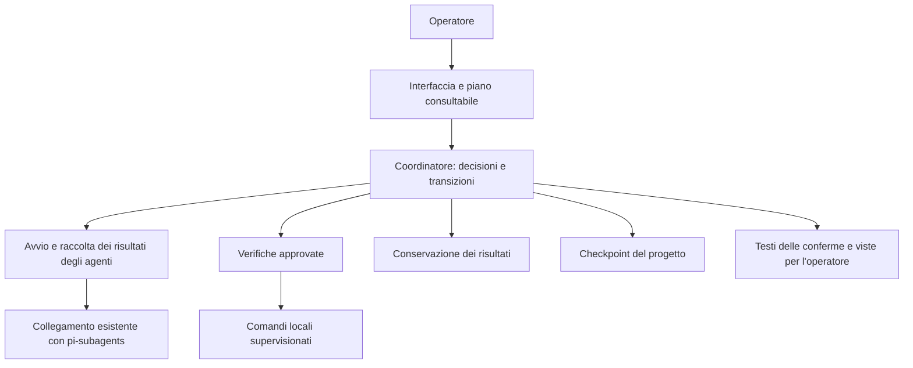

# Piano di affidabilità del package

[English](../RELIABILITY-PLAN.md) · **Italiano**

Data di avvio e conclusione: 19 ottobre 2026. Stato: passaggi previsti completati
con verifica combinata; limiti residui descritti sotto.

Il lavoro riguarda `pi-controlled-dev`. `pi-editorial-factory` è un riferimento
in sola lettura. Nella prima fase `test_src` doveva restare identico: nessuna
sessione Pi, stato, documentazione generata o ripresa del refactoring. La successiva
prova reale è stata autorizzata separatamente; il suo stato è descritto in fondo.

## Obiettivi e vincoli

- Conservare controllo dello scope, revisione indipendente, prove dei processi,
  autorizzazioni native, hash e contatori storici.
- Distinguere guasti del package, problemi dei modelli e verifiche del codice.
- Evitare che un salvataggio fallito faccia ripetere un risultato già accettato.
- Rendere verifiche lunghe osservabili e riprese riconciliabili.
- Ridurre il lavoro ripetuto senza usare timestamp come prova di integrità.
- Usare soltanto fixture sintetiche e directory temporanee con pulizia finale.

## Passaggi, nell'ordine concordato

| Passaggio | Attività e risultato verificabile | Stato |
|---|---|---|
| 1. Diagnostica | Errori di revisione con fase e condizione precisa; spiegazione umana; test di alterazione e mancato invio | Completato |
| 2. Risultati e salvataggi | Confine esplicito fra risultato accettato e checkpoint; guasto di conservazione riconoscibile e ripetibile senza nuovo agente | Completato |
| 3. Processi supervisionati | Verifiche asincrone, avanzamento e tempi reali; intenzione e conclusione durevoli; limiti su tempo e output | Completato |
| 4. Recupero e contatori | Unico trattamento delle verifiche interrotte; riconciliazione prima della ripresa; distinguere invii da preparazioni senza riscrivere la storia | Completato |
| 5. Letture e dipendenze | Riutilizzo di dati immutabili entro un'operazione verificata; riduzione delle scansioni e dei cicli fra moduli | Completato |
| 6. Verifica complessiva | Interruzioni sintetiche, regressioni, TypeScript, inventario del package, controlli workspace e confronto byte per byte di `test_src` | Completato con giro completo diagnostico e riesecuzioni mirate |

Ogni passaggio deve aggiornare questa pagina con implementazione, test eseguiti,
risultati e limiti. Un test mirato superato non certifica l'intero package.

## Soluzioni editoriali da confrontare

- `../../../pi-editorial-factory/docs/checkpoint-storage.md`: manutenzione
  successiva al commit, guasti differiti, avanzamento e tempi distinti.
- `../../../pi-editorial-factory/src/runtime/local-editorial-process.mjs`:
  processo locale supervisionato, richieste ordinate, errori di uscita e IPC.
- Contesti verificati privati e lettori comuni: riuso delle verifiche senza
  trasformare un dato ricevuto dal modello in un'autorizzazione.

Il confronto riguarda i principi e i confini. Nessuna dipendenza fra package,
nessuna copia del controller editoriale, nessuna ripresa di Darktable.

## Registro delle verifiche

- Punto di partenza: TypeScript valido; precedente gruppo mirato 75/76,
  con un confronto di hash storico di `package-lock.json` fallito.
- Baseline dei sorgenti e di `test_src` acquisita fuori dal repository, in una
  directory temporanea; modifiche preesistenti del package da preservare.

## Decisioni di progetto

Le operazioni già concluse mantengono identità e prove. Una ripresa deve decidere
dal journal quali effetti sono avvenuti; non deve ripetere automaticamente una
chiamata incerta. I messaggi dell'interfaccia devono indicare cosa accade, cosa
è stato conservato e quale passo è disponibile.

## Risultati dei primi passaggi

1. Diagnostica: 88/88 test di Reviewer e TUI. Il rifiuto conserva il campo
   fallito e la prova nativa di mancato invio; contenuti dei file e credenziali
   non entrano nella diagnosi.
2. Checkpoint: 65/65 test di coordinamento, salvataggio e importazione. Un
   errore di spazio simulato dopo il risultato del Developer conserva candidato,
   risultato e contatori; `checkpoint` ritenta soltanto il salvataggio.
3. Il servizio dei comandi e il servizio delle verifiche sono separati dal
   coordinatore. Il percorso di produzione usa attese asincrone, un gruppo di
   processi dedicato, limiti di tempo/output e un journal di intenzione, avvio
   e conclusione. Le regressioni di integrazione sono state eseguite.
4. I testi delle conferme sono ora una proiezione separata dal coordinatore.
   Un recupero sintetico con processo originale realmente terminato ha
   conservato candidato e tentativi; mancanze e corruzioni sono casi distinti.

## Confronto con il package editoriale

Adottati: errore di conservazione separato dal risultato già accettato;
separazione fra decisioni, processi e presentazione; guasti di visualizzazione
senza effetti sull'esito; tempi dei controlli distinti dal lavoro del modello.
Nel package editoriale gran parte del lavoro viene eseguita in un processo
separato, così l'interfaccia può continuare a mostrare l'avanzamento e ricevere
le richieste dell'operatore. In `pi-controlled-dev` separiamo per primi i comandi
di verifica, come i test: il sistema ne segue l'avvio, l'avanzamento e la fine.
Per avviare gli agenti rimane il collegamento già presente con `pi-subagents`.
Anche il package editoriale può usare `pi-subagents`, scegliendo il proprio
adattatore Pi; dispone inoltre di un canale autorizzabile chiamato
`codex-native`. Il processo separato che mantiene disponibile l’interfaccia
può usare uno di questi collegamenti: sono due scelte indipendenti.
Le letture e i salvataggi richiedono interventi distinti: questa prima modifica
non sposta ancora tutto il lavoro fuori dal processo dell'interfaccia.

La rotazione e la compressione dei checkpoint editoriali non vengono trasferite
automaticamente: in questo package le prove storiche sono ancora necessarie per
verificare le revisioni registrate.

## Come sono distribuite le responsabilità

Questo schema descrive i compiti dei componenti. Il coordinatore e diversi
servizi restano nel processo Pi; i comandi di verifica sono processi distinti.
Le operazioni su file e Git ancora sincrone sono un limite dichiarato, non un
passaggio già trasferito altrove.

| Componente | Sorgente | Verifica principale |
|---|---|---|
| Avvio degli agenti | [role-executor](../../src/role-executor.ts) | Contratti e risultati del coordinatore; revisione indipendente |
| Conservazione dei risultati | [workflow-result-store](../../src/workflow-result-store.ts) | Guasto prima della pubblicazione e ritentativo senza un nuovo Developer |
| Checkpoint | [workflow-checkpoint](../../src/workflow-checkpoint.ts) | Guasto dopo la pubblicazione, dati e tentativi conservati |
| Verifiche | [workflow-validation](../../src/workflow-validation.ts) | Comandi esatti legati alla versione del candidato |
| Processi dei comandi | [host-command](../../src/host-command.ts) | Output, durata, figli, rifiuto dell'arresto e guasti di conservazione |
| Recupero dei comandi | [host-command-recovery](../../src/host-command-recovery.ts) | Proprietario terminato, prove mancanti o alterate |
| Conferme leggibili | [human-gate-display](../../src/human-gate-display.ts) | Test dell'interfaccia e delle autorizzazioni native |

## Riduzione delle ripetizioni

- La revisione riusa gli elenchi di file già verificati e legge di nuovo i byte
  soltanto dei file da scrivere nella modifica proposta.
- Il ricontrollo di una modifica identica riusa la prova già riuscita della sua
  applicazione: evita di ricreare una copia completa del progetto. Restano
  obbligatori i controlli sui file attuali, sullo scope e sulla generazione.
- Gli hash degli artefatti vengono riusati solo durante la lettura di una stessa
  copia verificata. I controlli successivi sui contenuti restano obbligatori.
- La lettura dell'identità del progetto è indipendente dalla gestione dei
  candidati: è stato eliminato il precedente ciclo fra identità, collocazione
  dei dati e controllo dei file. Restano altri legami storici nel recupero.

## Verifiche aggiunte durante il lavoro

- 79/79 casi sui comandi e sull'integrazione; 47/47 su recupero e macchina a stati.
- 71/71 casi sui servizi estratti, sulla preparazione della revisione e sulle
  conferme. Dati della revisione errati vengono rifiutati prima di riservare
  un tentativo.
- 23/23 casi sui nuovi servizi; successivamente 145/145 casi finali su
  supervisione, recupero, preparazione della revisione, TUI, letture e macchina
  a stati. Il percorso sincrono precedente non può ereditare le garanzie di
  recupero di un controllo supervisionato.
- 14/14 casi su manuali, collegamenti bilingui e inventario distribuibile.
- Inventario e TypeScript verificati. Questi gruppi si sovrappongono: i conteggi
  non vanno sommati.
- Confronto di `test_src`: 357 file Python identici, zero file aggiunti.
- Il primo confronto editoriale ha verificato 795 file invariati. Un controllo
  successivo ha rilevato modifiche contemporanee in sei documenti del riferimento;
  i sorgenti sono rimasti identici. Questo lavoro non scrive nel package editoriale.

Nella prima esecuzione parallela alcuni test hanno raggiunto il limite del banco
prove prima di completare una preparazione sintetica. Il limite della fixture
che ricostruisce un intero flusso è stato distinto da quello del singolo comando;
i limiti approvati dei comandi di produzione restano invariati. Il caso che prova
l'arresto dei figli deve attendere che il programma abbia avuto tempo di avviarli.
Gli esiti della campagna completa e delle ripetizioni corrette sono riportati
separatamente sotto, senza trasformare le esecuzioni diagnostiche in successi.

## Esito finale e limiti

Il giro completo dei 70 file di test portabili ha registrato **1.344 casi:
1.337 riusciti, 5 falliti, 2 saltati per impostazione predefinita**, in 25 minuti
e 59 secondi con quattro processi di test. Era iniziato prima delle ultime
modifiche: non rappresenta un unico giro finale senza errori.

I cinque fallimenti sono stati analizzati e corretti. Due riguardavano i tempi
di preparazione delle fixture; due l'allineamento dei documenti bilingui e della
versione del manuale. Il quinto ha individuato un errore reale: il risultato dello
Scout, conservato insieme alle risposte dell'operatore, veniva verificato usando
l'incarico del Reviewer. Ora viene verificato con il proprio incarico originale,
solo se risulta accettato e terminato. I test rifiutano ancora attribuzioni
alterate e terminazioni non provate.

Le riesecuzioni finali sono riuscite: **145/145**, **14/14** e **42/42**. L'ultimo
gruppo copre la correzione Scout e i relativi controlli di revisione. Tutti i cinque
fallimenti del giro diagnostico hanno una riesecuzione riuscita. La verifica è
combinata; non è stato ripetuto un secondo giro completo dopo l'ultima correzione.

I casi singoli più lunghi sono stati il progetto nuovo con quattro task e
checkpoint finale (343 secondi), il percorso guidato con due task (184 secondi)
e il recupero di una promozione già applicata (176 secondi). Questi sono tempi
del banco prove sintetico su questa macchina, non una stima di un refactoring
con modelli reali.

Riusciti anche TypeScript, controllo del diff e controlli del workspace, incluso
il relativo test automatico. Alla conclusione di quella fase `test_src` conservava solo i 357 file Python originali,
senza file o cartelle aggiunti. Nessuna sessione Pi è stata avviata; nessuna
installazione globale, pubblicazione o push è stato eseguito. La versione locale
di sviluppo è `0.1.0-beta.4`.

Questa è una prima separazione dei servizi: il coordinatore conserva ancora
circa 2.000 righe e legami storici nel recupero. Le operazioni su file e Git ancora
sincrone possono occupare il processo della TUI. Spostarle in un servizio locale
separato, mantenendo l'adattatore esistente verso `pi-subagents`, resta il passo
successivo per la reattività su progetti grandi. La supervisione Linux usa gruppi
di processi; non isola programmi che si distaccano deliberatamente dal gruppo.
Le prove native con modelli reali e la prova completa su un'altra macchina non
erano comprese in quella verifica.

## Prova reale e leggibilità del codice — aggiornamento del 19 ottobre

La prova successiva usa la TUI Pi, GPT 6.1 sol con ragionamento medio e il package
locale. Stato e documentazione sono nella cartella del progetto; le credenziali
restano sulla macchina. Pi ha raccolto tre indagini, richiesto quattro decisioni
all'operatore e prodotto un piano di tredici attività. Le decisioni e il piano
sono stati approvati. Il primo intervento prepara le verifiche, prima di modificare
la libreria. Questo aggiornamento non dichiara concluso il refactoring.

La verifica di leggibilità ha esaminato le istruzioni effettivamente inviate a
Developer e Reviewer, il coordinatore, la pianificazione, l'autonomia e i servizi
recentemente separati. Non è una revisione riga per riga di tutti i moduli.

Aspetti validi: tipi espliciti, contratti verificati, ruoli con permessi distinti,
servizi con responsabilità riconoscibili e guida che privilegia riuso e semplicità.
Le istruzioni sulla qualità raggiungono entrambi i ruoli. Il Reviewer deve valutare
anche comprensibilità e struttura, oltre alle prove funzionali.

Correzioni applicate:

- nomi espliciti nei servizi di esecuzione e recupero dei comandi, verifica del
  candidato e conservazione dei risultati: per esempio `commandRecord`,
  `intentRecord`, `pendingOperations`, `stdoutChunks`, `monotonicStartMs`;
- decisioni e mutazioni separate su righe leggibili, unità esplicite per tempi
  e dimensioni, formato del journal descritto da un tipo interno;
- istruzioni più precise per variabili, funzioni, classi, condizioni booleane
  e unità di misura; un rilievo del Reviewer deve citare il simbolo e spiegare
  l'ambiguità concreta, preservando i nomi pubblici compatibili.

Restano parti troppo dense, soprattutto il coordinatore, il ponte di produzione
e diversi percorsi di pianificazione/autonomia. Nomi come `CentralOrchestrator`
descrivono bene il ruolo generale, ma non risolvono da soli le troppe responsabilità
residue. La revisione successiva deve procedere per responsabilità e piccoli
passaggi verificati. Il numero di righe non è un obiettivo di qualità: aggiungere
spazio per rendere espliciti i controlli è preferibile a comprimere più operazioni.

Le rinomine di questa verifica conservano API, campi persistenti, hash, limiti,
contatori e regole di autorizzazione. Le prove di regressione coprono processi
figli reali, timeout, output eccessivo, arresto incerto, journal alterato o
incompleto e ritentativo dei salvataggi senza un secondo Developer.

Verifica di questo intervento: **95/95 test** sui servizi, sui ruoli e sulla guida;
poi **80/80 test** dopo aver aggiunto il controllo delle istruzioni negli incarichi
effettivamente inviati, inclusi inventario e documentazione bilingue. I due gruppi
si sovrappongono. Riusciti anche TypeScript, controllo del diff, controlli del
workspace e i relativi due test. Nessuna nuova esecuzione completa di tutte le
suite è implicita in questi risultati.

### Coerenza del protocollo delle proposte

Il primo task della prova reale è stato completato e integrato localmente dopo
386 test riusciti e revisione indipendente PASS. Il Developer ha impiegato
40,433 secondi; il Reviewer 34,004 secondi. Sono stati aggiunti solo la
configurazione pytest e il controllo dell'ambiente, senza modifiche agli algoritmi.

La proposta del secondo task ha individuato un difetto del package: il formato
fornito allo Scout ammetteva `configPath` nei controlli `EXISTING_TEST`, mentre il
validatore lo rifiutava. Lo Scout aveva consegnato una risposta completa in
80,739 secondi; il rifiuto successivo non era un agente rimasto senza risposta.
Un confronto diagnostico in memoria ha isolato il campo responsabile. La vecchia
risposta non è stata trasformata in un risultato accettato.

Ora il formato distingue esplicitamente i quattro tipi di verifica e ammette
`configPath` soltanto per `CANDIDATE_TEST`. La guida spiega che un controllo della
suite esistente esegue la suite standard e che i suoi percorsi descrivono la
copertura, senza selezionare singoli file. Una proposta rifiutata può esporre il
campo coinvolto, senza mostrare il contenuto della risposta. Restano obbligatori
verifiche semantiche, percorsi osservati, autorizzazioni e limiti storici.

Verifiche: **122/122 test**, TypeScript, diff e **1/1** test mirato dopo l'ultimo
affinamento del messaggio. Il validatore della Pi installata ha accettato quattro
varianti valide e rifiutato quattro varianti errate, oltre alla risposta reale
originariamente rifiutata. Questa prova non ha inviato richieste a un modello.
Pi viene riavviata con il package corretto prima di una nuova preparazione esplicita.

### Commenti nei sorgenti e sequenza delle verifiche

La richiesta successiva dell'operatore rende esplicita la qualità dei commenti:
nei file nuovi o modificati in modo sostanziale, una breve descrizione del modulo
deve spiegare responsabilità e confini; contratti pubblici e logica non ovvia
devono chiarire unità, effetti, errori, ipotesi e invarianti pertinenti. I commenti
devono corrispondere al codice e non limitarsi a ripetere le istruzioni.

Sono stati rivisti i commenti in nove moduli dei servizi, dell'identità Git e
delle proposte. Il confronto dei token JavaScript emessi conferma che questi
soli interventi ai commenti non modificano il codice eseguibile. **82/82 test**
verificano ruoli e guida, compresa la consegna dei criteri a Developer e Reviewer;
TypeScript è valido. Questo non certifica ancora i commenti di ogni file del package.

La nuova preparazione del secondo task è riuscita con il protocollo corretto.
La proposta richiede però nuovi test eseguiti prima di modificare il codice di
produzione: il Developer non dispone di comandi e il controllo dell'host avviene
dopo la consegna. Il task non è stato creato con questa sequenza impraticabile.
La guida di pianificazione richiede incrementi distinti per caratterizzazione
verificata e successivo refactoring, senza indebolire i risultati attesi o
inventare una verifica intermedia.

### Consegna del piano e interruzioni della connessione

Una revisione del piano ha consegnato una risposta di 42.680 byte con i riferimenti
alle memorie nel formato di conservazione, mentre il protocollo dello Scout
richiede soltanto gli identificatori. La risposta è stata rifiutata; successivi
errori di connessione hanno esaurito i tentativi del provider. Il processo è
terminato dopo 300,834 secondi: il limite di dieci minuti non era scaduto e non
c'è stata un'interruzione manuale.

Il contesto del piano precedente viene ora presentato allo Scout con i campi
del suo protocollo. Il piano conservato, i suoi identificatori e il digest non
cambiano; il testo chiarisce che il digest identifica l'originale, non la proiezione.
I normali controlli semantici e la conferma della nuova revisione restano necessari.

La diagnosi riconosce gli errori nativi osservati `WebSocket error`, `terminated`,
`Connection error.` e `fetch failed`, senza trattare una frase del modello come
prova di un guasto. La fine fisica del processo resta un controllo separato.
L'interfaccia distingue una connessione interrotta da una risposta non valida e
non dichiara terminato un processo ancora incerto.

Verifiche riuscite: **99/99 test** su proposte e TUI, **81/81** nell'intera suite
di pianificazione, **2/2** sul contesto e **1/1** sui messaggi di connessione,
con sovrapposizione fra i gruppi; TypeScript e diff validi. Una prima versione
della nuova fixture presumeva una copia modificabile: il codice conserva invece
i dati inerti immutabili. La fixture è stata corretta senza indebolire quella garanzia.

Per la successiva prova di pianificazione è configurato il trasporto SSE nelle
sole impostazioni locali del progetto. Il lettore reale delle impostazioni Pi
lo riconosce; questo controllo non invia richieste a modelli e non dimostra ancora
che i guasti di rete siano risolti.

## Aggiornamento per la pubblicazione — 21 ottobre 2026

Sorgenti e test beta.4 hanno ora una nuova verifica portabile completa. Il
[resoconto corrente](VALIDATION.md) riporta conteggi esatti, prove native di
installazione/connessione, controlli SSD e limiti. La pubblicazione GitHub conserva
come storia le fasi precedenti ed esclude sessioni e stato grezzo della prova reale.
Non conclude il refactoring reale separato né elimina le operazioni sincrone
residue di filesystem/Git. I manuali descrivono l'aggiornamento da Git e le versioni
minime per riaprire copie condivise ed evidenze dei processi asincroni.
